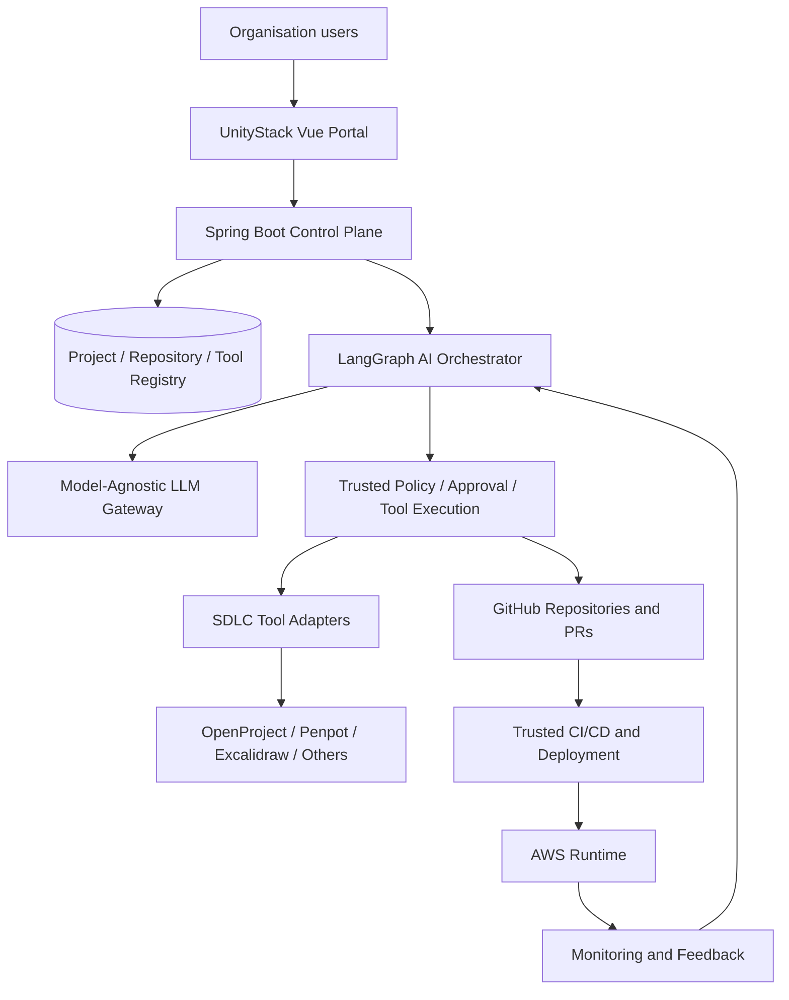

# UnityStack — Product Requirements Document

**Product:** UnityStack — Enterprise AI Software Factory in a Box  
**Document type:** Product Requirements Document (PRD) / High-Level Requirements  
**Version:** 1.2 (AI-first and enterprise adoption draft)  
**Status:** Draft for human review  
**Date:** 21 November 2026  
**Initial deployment target:** AWS  

**Change log v1.2:** Adds AI-first two-pane UX, versioned previews, AI-driven BRD/epic/story generation, configurable review, traditional SDLC coexistence, passive sync, source ownership, Hello World continuous delivery, stable traceability, enterprise onboarding and historical ingestion. Existing v1.1 sections retained; later v1.2 sections clarify superseding decisions.

## 1. Executive Summary

UnityStack is a self-hosted, AI-native, Git-driven software development lifecycle (SDLC) platform. An organisation installs a versioned UnityStack distribution in its own AWS environment and receives a unified portal plus a preconfigured ecosystem of open-source engineering tools. UnityStack coordinates the lifecycle from business requirements and UX design through architecture, implementation, testing, delivery, production monitoring and subsequent improvements.

**Guiding workflows:** (A) AI conversation → live preview and revisions → user finalises → PR → policy-governed merge → delivery; (B) teams work entirely in existing SDLC tools → UnityStack observes events, reconciles source records and reconstructs traceability. Neither workflow depends on the other.

**Core principle:** GitHub is authoritative for Git repositories, commits, branches, PRs and Git-versioned approved artifacts. Each connected SDLC tool remains authoritative for its native operational records. UnityStack owns AI drafts, orchestration, derived indexes and traceability links. Runtime logs, metrics, secrets and ephemeral workflow state are not stored in Git.

## 2. Objectives

1. Provide an installable **Enterprise AI Software Factory in a Box** for individual organisations.
2. Provision and maintain UnityStack and its selected SDLC tools on AWS through Terraform and deployment automation.
3. Make GitHub the authoritative store for versioned project artifacts and approved changes.
4. Enable AI agents to propose changes without bypassing human governance.
5. Support multiple organisations through **independent installations** in the MVP, and multiple projects and repositories inside each installation.
6. Integrate established open-source tools rather than rebuilding them.
7. Keep AI model providers interchangeable behind a model-agnostic gateway.
8. Establish a modular tool-adapter architecture to support future customer-selected tools.

## 3. Scope and Release Boundaries

### 3.1 MVP — Required

- A versioned, self-hosted UnityStack package deployable into an organisation's AWS account.
- Terraform-managed AWS infrastructure and scripted application deployment.
- Full installation profile that deploys **all nine selected tools**, with health checks and access through a UnityStack portal.
- Vue-based UnityStack portal; Spring Boot control-plane backend; Python-based AI orchestration service (LangGraph) and swappable LLM gateway (LiteLLM or equivalent selected during implementation).
- Organisation configuration, project registry, GitHub repository registry and artifact-location mappings.
- A working **AI-first requirements** vertical slice: conversational discovery → AI-generated BRD/epic/story proposal → read-only live preview and revision diff → user finalises → GitHub PR → configurable reviewer policy → merge → publish approved stories to OpenProject.
- Initial OpenProject integration for project management, including passive observation of native work-item changes and publication of approved AI-generated stories, with explicit authority and synchronisation rules.
- Observe developer-created GitHub PRs and existing CI/CD events without requiring UnityStack participation; provide webhook ingestion and basic periodic reconciliation.
- Walking-skeleton application delivery: deploy Hello World to a production-designated environment early, then continuously deliver governed increments.
- Role-specific two-pane AI chat + live read-only preview, with versioned changes and finalise/create-PR actions.
- Install/upgrade/backup/restore/health-check operational foundations appropriate for a non-HA MVP.
- GitHub-first governance and auditability.
- Basic central identity foundation, role mapping and trusted execution boundaries (complete SSO coverage across all tools is not required).
- Basic SDLC capability registry and one provider adapter per implemented capability; dynamic BYOT selection remains future scope.

### 3.2 Incremental Post-MVP Integrations

- Deeper AI-assisted workflows for wireframes, UX, architecture, APIs, implementation, testing, infrastructure, delivery and production feedback.
- Automated cross-repository change sets and dependency coordination.
- Full tool-specific integrations and agent operations for each of the nine applications (installation and availability are MVP; complete AI integrations are incremental).
- Advanced agent evaluation, observability, governance, and policy enforcement.
- Full cross-tool SSO coverage, HA, scalable Kubernetes/EKS deployment and production-grade disaster recovery.

### 3.3 Future Vision — Not MVP Commitments

- **Bring Your Own Tool (BYOT):** choose the default tool, connect an existing enterprise tool (e.g., Jira), or provision a different supported tool where permitted.
- Additional providers per SDLC capability (e.g., Plane or Jira for project management).
- Azure/GCP deployment packages and additional Git providers.
- Full multi-tenant SaaS, if subsequently required; MVP remains one independent installation per organisation.
- Enterprise onboarding for established organisations: connect existing providers, historical ingestion/backfill, cross-tool relationship reconstruction, completeness reports and ongoing synchronisation.
- Optional direct editing via browser/offline IDE launch; not required for MVP.

## 4. Stakeholders and User Roles

| Role | Responsibility |
|---|---|
| Organisation Administrator | Install/configure UnityStack, manage tool access and organisational policies |
| Project/Product Owner | Manage requirements, priorities and acceptance |
| Business Analyst | Refine requirements, epics and stories |
| UX Designer | Review wireframes and UX artifacts |
| Solution Architect | Review architecture, ADRs and API contracts |
| Developer | Review and implement code changes |
| QA Engineer | Review tests and quality evidence |
| DevOps/SRE | Manage infrastructure, releases, observability and incidents |
| AI Agent | Propose artifacts/actions only within granted tool permissions |

## 5. Selected Tool Stack — Baseline

The following nine choices are **finalised for the initial distribution**. Other SDLC tool selections remain open.

| Capability | Selected Tool | Repository | Git-first treatment |
|---|---|---|---|
| Epics, stories, bugs, project management | OpenProject | https://github.com/opf/openproject | Sync approved canonical work-item representations with Git; OpenProject retains operational database |
| Initial wireframes | Excalidraw | https://github.com/excalidraw/excalidraw | Version editable `.excalidraw` JSON artifacts |
| UX/UI design and prototypes | Penpot | https://github.com/penpot/penpot | Version supported exports/tokens/prototypes; define synchronization with native editable designs |
| Architecture diagrams | Mermaid | https://github.com/mermaid-js/mermaid | Version `.mmd` or Markdown Mermaid source |
| Technical documentation | MkDocs | https://github.com/mkdocs/mkdocs | Version Markdown and `mkdocs.yml` |
| Software/service catalog | Backstage | https://github.com/backstage/backstage | Version `catalog-info.yaml` descriptors |
| API documentation | Swagger UI | https://github.com/swagger-api/swagger-ui | Version OpenAPI YAML/JSON specs; Swagger UI renders them |
| Web-based IDE | Eclipse Theia | https://github.com/eclipse-theia/theia | Edit project repositories through governed Git workflows |
| Code quality | SonarQube Community Build | https://github.com/SonarSource/sonarqube | Version supported quality configuration; analysis results remain in SonarQube |

**Important:** An installed tool does not automatically imply full integration, SSO or feature parity. Deployment packages must validate compatible versions, licensing, runtime dependencies and any tool-specific limitations.

## 6. Functional Requirements

Priority notation: **P0** = MVP essential; **P1** = next increment; **P2** = future.

### 6.1 Packaging, Installation and Operations

| ID | Priority | Requirement |
|---|---|---|
| FR-001 | P0 | Deliver a versioned UnityStack distribution with infrastructure modules, container/deployment definitions, configuration templates and installer scripts. |
| FR-002 | P0 | Accept organisation-specific AWS region, domain, GitHub organisation, AI provider and deployment profile settings. |
| FR-003 | P0 | Use Terraform to provision required AWS resources with repeatable `plan` and `apply` workflows. |
| FR-004 | P0 | The **full** installation profile deploys UnityStack and all nine selected tools, with their required dependencies. |
| FR-005 | P0 | Display each tool in a unified portal with endpoint, installation state and health status. |
| FR-006 | P0 | Make installation idempotent where practical; rerunning deployment must not destroy persistent data. |
| FR-007 | P0 | Pin application and infrastructure versions in a release manifest. |
| FR-008 | P0 | Provide backup/restore procedures, health checks and documented upgrade/rollback steps. |
| FR-009 | P1 | Support optional core/custom installation profiles and independently managed application stacks. |
| FR-010 | P1 | Provide scheduled drift checks, update recommendations and operational dashboards. |

### 6.2 Organisation, Project and Repository Registry

| ID | Priority | Requirement |
|---|---|---|
| FR-011 | P0 | Support multiple projects within one organisation's independent UnityStack installation. |
| FR-012 | P0 | Register one or many GitHub repositories per project. |
| FR-013 | P0 | Support monorepo, multi-repo, microservice-per-repository and hybrid repository arrangements. |
| FR-014 | P0 | Map SDLC artifact types to repository, branch and path; agents must resolve destinations through the registry rather than hard-coded folders. |
| FR-015 | P0 | Allow multiple repositories for the same artifact type (e.g., multiple service and test repositories). |
| FR-016 | P1 | Support shared organisational repositories for standards, libraries and templates. |
| FR-017 | P1 | Track related PRs across repositories as a logical change set with dependencies and merge status. |

### 6.3 Git-Based Artifact Lifecycle

| ID | Priority | Requirement |
|---|---|---|
| FR-018 | P0 | Treat approved GitHub content as the canonical version of durable, reviewable SDLC artifacts. |
| FR-019 | P0 | AI-generated changes must be made on branches and proposed through PRs; no direct AI push to protected branches. |
| FR-020 | P0 | Show the proposed artifact and diff before publication or approval. |
| FR-021 | P0 | Validate generated artifacts against applicable schemas and project rules before creating a PR. |
| FR-022 | P0 | Preserve actor, prompt/run reference, source requirement, artifact version, PR URL and approval status for auditability. |
| FR-023 | P1 | Maintain traceability across requirement → design → code → tests → deployment → production feedback. |
| FR-024 | P1 | Detect and reconcile changes made directly in connected tools to prevent uncontrolled divergence from Git. |
| FR-025 | P1 | Coordinate multi-repository changes without assuming cross-repository atomic merges. |

### 6.4 AI Control Plane

| ID | Priority | Requirement |
|---|---|---|
| FR-026 | P0 | Provide an AI gateway that can change model providers by configuration with minimal application changes. |
| FR-027 | P0 | Implement an AI Business Analyst workflow that transforms user input into structured requirements-as-code. |
| FR-028 | P0 | Separate AI reasoning and requested actions from trusted identity, authorisation, validation, approval and tool execution. |
| FR-029 | P0 | Enforce organisation-configured reviewer approval for PR merges (review may be optional for permitted repositories), mandatory policy/quality gates, and separately configured infrastructure/production deployment authorisation. User finalisation of an AI proposal is always explicit. |
| FR-030 | P0 | Record agent execution state, failures, retries and tool-call audit events. |
| FR-031 | P1 | Add specialised UX, Architecture, Developer, QA and Operations agent capabilities progressively. |
| FR-032 | P1 | Introduce MCP-based tool integration where it adds value, with controlled permissions and validation. |
| FR-033 | P1 | Add RAG over authorised project documents, agent evaluation, model-cost and latency tracing. |
| FR-034 | P1 | Enforce retry limits, budgets, timeouts and human escalation for failed or ambiguous agent actions. |

### 6.5 SDLC Tool Integrations

| ID | Priority | Requirement |
|---|---|---|
| FR-035 | P0 | Deploy and expose OpenProject, Excalidraw, Penpot, Mermaid rendering, MkDocs, Backstage, Swagger UI, Theia and SonarQube Community Build. |
| FR-036 | P0 | Integrate OpenProject sufficiently to associate initial requirements/work items with Git-backed artifacts; document sync ownership and conflict handling. |
| FR-037 | P1 | Generate/review Excalidraw wireframes and Penpot design outputs with Git-backed artifacts. |
| FR-038 | P1 | Generate Mermaid diagrams and ADR documentation through human-reviewed PRs. |
| FR-039 | P1 | Publish Markdown documentation through MkDocs and OpenAPI specifications through Swagger UI. |
| FR-040 | P1 | Register software components in Backstage using Git-versioned catalog descriptors. |
| FR-041 | P1 | Integrate Theia development workflows and SonarQube quality results into PR review. |
| FR-042 | P0 | Introduce a basic capability registry and stable provider-independent interfaces for MVP integrations; advanced operation discovery is P1. |
| FR-043 | P2 | Allow each capability to use a UnityStack-provisioned default, an existing customer instance, or a supported alternative provider. |

### 6.6 Delivery and Production Feedback

| ID | Priority | Requirement |
|---|---|---|
| FR-044 | P1 | Version tests, CI/CD pipelines, IaC and monitoring configuration in Git. |
| FR-045 | P1 | Execute validation and deployment through trusted pipelines with environment approvals. |
| FR-046 | P1 | Connect production signals to incident/improvement proposals and human-reviewed PRs. |
| FR-047 | P1 | Maintain release, deployment, quality and incident traceability to relevant Git commits and change sets. |

## 7. Canonical Artifact Types and Repository Flexibility

UnityStack must not assume that all artifacts live in a single repository or in fixed root directories.

| Artifact type | Typical Git representation | Example repository |
|---|---|---|
| Requirements / epics / stories / bugs | Markdown / YAML | `banking-requirements` |
| Initial wireframes | `.excalidraw` JSON | `banking-wireframes` |
| UX artifacts | Design exports, tokens, Vue prototype source | `banking-ux` |
| Architecture | Mermaid, ADR Markdown | `banking-architecture` |
| API contracts | OpenAPI YAML/JSON | `banking-api-contracts` |
| Application code | Java, Vue, etc. | `banking-customer-service` |
| Tests | Unit, integration, E2E, performance/security definitions | `banking-tests` |
| Infrastructure | Terraform / deployment manifests | `banking-infrastructure` |
| CI/CD | GitHub Actions YAML | Relevant source/infrastructure repositories |
| Observability configuration | Dashboard/alert/SLO definitions | `banking-observability` |
| Documentation | Markdown, MkDocs config | `banking-docs` |
| Catalog metadata | `catalog-info.yaml` | Source or catalog repository |

### 7.1 Example Repository Registry

```yaml
organization: abc-bank
project: digital-banking
repositories:
  - id: requirements
    provider: github
    repository: abc-bank/banking-requirements
    defaultBranch: main
    artifacts:
      - type: requirement
        path: requirements/
      - type: story
        path: stories/
  - id: architecture
    provider: github
    repository: abc-bank/banking-architecture
    defaultBranch: main
    artifacts:
      - type: diagram
        path: diagrams/
      - type: adr
        path: adrs/
  - id: customer-service
    provider: github
    repository: abc-bank/banking-customer-service
    defaultBranch: main
    artifacts:
      - type: source-code
        path: src/
      - type: unit-test
        path: src/test/
```

This is an illustrative configuration, not a final schema.

## 8. Reference Architecture



**Architecture boundaries:**

- **Control plane:** Vue portal, Spring Boot API, project/repository registry, identity/policy and workflow oversight.
- **AI plane:** Python LangGraph workflows and a swappable LLM gateway; models do not hold direct unrestricted infrastructure permissions.
- **Integration plane:** GitHub and SDLC tool adapters, optionally exposed via MCP with trusted execution.
- **Data plane:** GitHub for canonical artifacts; PostgreSQL for application/workflow metadata; tool databases for operational tool data; AWS storage for backups/files; monitoring backends for telemetry.
- **Deployment plane:** Terraform provisions AWS; deployment automation configures/updates containers; CI/CD remains subject to approvals.

## 9. AWS MVP Deployment Requirements

### 9.1 Initial Deployment Approach

- Target **AWS only** in the MVP.
- Use **Terraform** to provision AWS resources.
- Start with **EC2 + Docker Compose** for the non-HA MVP, while allowing tools to be distributed across more than one host if resource sizing requires it.
- Use S3 for remote Terraform state and relevant backups; implement suitable state locking and encryption.
- Use IAM least privilege and GitHub OIDC for trusted CI workflows.
- Use AWS Secrets Manager or Systems Manager Parameter Store for secrets; do not commit secrets to Git.
- Use ECR for UnityStack container images where appropriate.
- Provide TLS/HTTPS access, protected administrative interfaces, backups and health checks.
- Allow local Docker-based development without requiring AWS deployment.

### 9.2 Distribution Layout (Proposed)

```text
unitystack-distribution/
├── installer/
│   ├── install.sh
│   ├── upgrade.sh
│   ├── validate.sh
│   └── uninstall.sh
├── terraform/
│   ├── bootstrap/
│   ├── aws/
│   └── modules/
├── deployment/
│   ├── unitystack/
│   ├── openproject/
│   ├── excalidraw/
│   ├── penpot/
│   ├── mermaid/
│   ├── mkdocs/
│   ├── backstage/
│   ├── swagger-ui/
│   ├── theia/
│   └── sonarqube/
├── config/
│   └── organization.example.yaml
├── manifests/
│   └── versions.yaml
└── README.md
```

The installer must support organisation-specific configuration without requiring source-code modifications. Deployment manifests must pin versions and document persistent volumes and upgrade compatibility.

### 9.3 Example Installation Configuration

```yaml
organization:
  name: ABC Bank
  domain: unitystack.example.org
cloud:
  provider: aws
  region: eu-west-2
deployment:
  profile: full
ai:
  provider: configurable
github:
  organization: abc-bank
```

Configuration is illustrative; secrets and credentials must be supplied through secure channels.

## 10. Human Review, Security and Governance

1. AI-generated artifacts must be attributable to an agent run and source request.
2. Agents may draft changes but may not directly merge protected PRs or execute unapproved production actions.
3. GitHub branch protection, required checks and human approvals govern canonical changes.
4. A trusted execution layer validates authorisation, tool permissions, input schemas and policy before acting.
5. GitHub access should use a GitHub App or another narrowly scoped credential mechanism.
6. Each installation must isolate organisational data and credentials.
7. Secrets, tokens and personal/sensitive runtime information must not be written to Git or model prompts unnecessarily.
8. Infrastructure plans, upgrades and destructive operations require explicit authorisation.
9. Every external integration must define its authority, sync direction, conflict resolution and audit events.
10. Operational databases, metrics and logs remain in systems suited to those workloads; only their code/configuration and references are versioned in Git.

## 11. Non-Functional Requirements

| ID | Category | Requirement |
|---|---|---|
| NFR-001 | Reproducibility | Same versioned package and configuration should produce functionally equivalent deployments. |
| NFR-002 | Security | Encrypt data in transit/at rest where supported; apply least privilege, protected secrets and audited administrative access. |
| NFR-003 | Isolation | Each MVP organisation has its own installation and isolated credentials, databases and resources. |
| NFR-004 | Extensibility | Tool integrations use stable capability contracts rather than embedding provider-specific logic in agents. |
| NFR-005 | Maintainability | Tool images/versions are pinned, documented and upgradeable independently where dependencies permit. |
| NFR-006 | Reliability | Installation detects failures, reports health and preserves persistent data during routine redeployments. |
| NFR-007 | Observability | Record platform health, errors, deployment outcomes and AI run metadata. |
| NFR-008 | Cost | Allow disabling nonessential services in development and document AWS cost drivers before full deployment. |
| NFR-009 | Portability | Keep cloud-specific logic in Terraform/deployment modules; AWS is the only MVP implementation. |
| NFR-010 | Performance | Define measurable response-time and capacity targets after an initial deployment benchmark. |
| NFR-011 | Recovery | Document and test backup/restore for persistent tool and platform data. |
| NFR-012 | Accessibility | Use accessible navigation and controls in the UnityStack portal. |


### 6.7 Additional Functional Requirements — v1.1

| ID | Priority | Requirement |
|---|---|---|
| FR-048 | P0 | Distinguish platform/tool installation, upgrade and recovery workflows from the SDLC lifecycle of customer software; maintain separate versions, roles and audit records. |
| FR-049 | P0 | Provide initial central identity, session management and platform RBAC; map platform identities to tool access where supported and document exceptions. |
| FR-050 | P0 | Maintain a capability registry mapping logical operations to installed provider adapters, configured endpoints, supported operations and health status. |
| FR-051 | P0 | Assign canonical ownership and synchronisation direction to each artifact type and tool; detect divergence and block silent overwrites. |
| FR-052 | P0 | Require agent action requests to pass through a trusted policy/authorisation/execution layer with scoped credentials and approval checks. |
| FR-053 | P0 | Capture stable artifact identifiers, Git commit/ref, source request and agent-run linkage for all MVP-generated artifacts. |
| FR-054 | P0 | Record installation phase outcomes, readiness failures, backup verification and repeat-deployment results in an inspectable report. |
| FR-055 | P1 | Define durable events, idempotent handlers, retry/dead-letter behaviour and recovery for long-running SDLC workflows and external webhooks. |
| FR-056 | P1 | Support traceability links among requirements, architecture, APIs, implementation, tests, releases and operational feedback. |
| FR-057 | P1 | Provide organisation onboarding templates and validation for domain, region, repositories, identity, AI settings and tool endpoints. |
| FR-058 | P1 | Support dependency-aware multi-repository change sets with explicit handling for partial merges and compensation plans. |
| FR-059 | P1 | Provide cost/resource reporting and documented deployment sizing profiles based on measured usage. |
| FR-060 | P2 | Allow users to select an alternative provider, connect an existing enterprise instance, or provision a supported alternative per capability (BYOT). |

## 11A. Platform Lifecycle Management

**Two separate lifecycle domains are mandatory:** (a) UnityStack distribution and installed SDLC tools; (b) software products managed by UnityStack. A platform upgrade must not implicitly trigger a managed-product release.

- **Install:** Validate prerequisites, Terraform plan, explicit apply approval, application deployment, initial admin setup and service readiness.
- **Configure:** Validate organisation configuration, endpoints, secrets references, identity mappings and integration credentials.
- **Upgrade:** Pin versions, review release notes and migration requirements, back up state, execute compatibility checks, request approval, deploy and verify.
- **Rollback/recovery:** Document per-component rollback feasibility, database migration compatibility and restore-from-backup procedures; never promise automatic rollback of irreversible migrations.
- **Uninstall:** Require explicit confirmation and independent decisions for retaining or deleting persistent data and backups.
- **Versioning:** Track UnityStack distribution version, each tool version, deployment configuration revision and Terraform state independently.

**Acceptance:** A repeat installation of the same release preserves persisted data; a simulated failed component upgrade yields a diagnostic report and documented recovery path.

## 11B. Identity, Authorisation and Agent Security

- **Identity model:** Distinguish human requester/approver, logical AI agent identity and trusted service/execution identity. Record all three where applicable.
- **MVP access:** Provide central platform authentication and roles such as organisation admin, project contributor, reviewer and read-only viewer. Tool-specific accounts or SSO exceptions must be visible to administrators.
- **SSO roadmap:** Evaluate an identity provider such as Keycloak and OIDC/SAML support per tool and edition; do not assume complete SSO integration is included in MVP.
- **Least privilege:** Use scoped GitHub App permissions, AWS IAM roles, expiring credentials where available and separate read/propose/execute privileges.
- **Trusted action boundary:** The LLM proposes an action; a non-LLM component checks policy, identity, target, schema, budget and approval before execution.
- **Untrusted input:** Treat repository files, retrieved documents, tool output and external issue text as untrusted; prevent prompt-injection instructions from overriding system policy.
- **Execution safety:** Sandboxed code execution, secret redaction, outbound access controls, approval for infrastructure/production actions, audit events and emergency revocation are required as capabilities mature.
- **No implicit approval:** A successful LLM response or automated test is never a substitute for required human review.

**Acceptance:** An AI agent cannot merge a protected PR, obtain an unrestricted AWS credential or deploy to production without the applicable trusted policy and approval checks.

## 11C. Canonical Artifact Ownership and Reconciliation

Every artifact mapping must record: stable artifact ID, type, owning Git repository/path/branch, canonical format, originating tool, synchronisation direction, last synced Git commit, tool revision and sync status.

**Canonical lifecycle:** Draft → Validate → Proposed PR → Human Review → Merge → Synchronise connected tools → Verify.

- Git remains authoritative for approved, reviewable artifacts; working drafts may temporarily live in specialised tools.
- For OpenProject, define whether the initial integration is Git-to-tool only or a controlled tool-to-PR proposal flow. Do not assume native two-way synchronisation.
- For Penpot, document which editable design representation is authoritative, export fidelity and limitations before enabling automated sync.
- On concurrent edits or mismatched revisions, flag a conflict and require explicit reconciliation; never silently overwrite Git or native tool state.
- Use idempotency keys and optimistic revision checks to avoid duplicate PRs and replayed updates.
- Failed publication/synchronisation must be visible, retryable and auditable without treating an unmerged proposal as approved state.

**Acceptance:** A simulated conflicting edit cannot silently replace an approved Git artifact; the system reports both versions and a resolution path.

## 11D. Tool Capability Registry and Provider Contracts

Introduce a basic registry in the MVP even though UI-driven Bring Your Own Tool remains future scope. Each capability record should include provider ID, installation/connection mode, endpoint, authentication reference, health, supported operations and scope.

Example logical operations: `projectManagement.createStory`, `architecture.publishDiagram`, `documentation.publishPage`, `quality.getGateStatus`.

- Agents call logical operations; adapters translate to OpenProject, Mermaid, MkDocs or other provider-specific APIs.
- Provider operations may be unsupported or edition-restricted; the registry must advertise capabilities and return explicit unsupported-operation errors.
- Provisioning a tool and connecting an existing instance are separate adapter concerns.
- Only one provider per implemented MVP capability is required; runtime provider switching and Jira/Plane alternatives remain future work.

## 11E. Workflow Events, Recovery and Cross-Repository Coordination

Define a versioned event envelope containing `eventId`, `eventType`, `occurredAt`, `organisationId`, `projectId`, `correlationId`, `actor`, `artifactRefs` and `schemaVersion`.

Example flow: `RequirementApproved` → `ArchitectureProposalRequested` → `ArchitecturePRCreated` → `PRMerged` → `CodeProposalRequested`.

- MVP may use a simple persistent workflow state and verified GitHub webhooks; a message broker is not mandatory.
- Event handlers must be idempotent, use bounded retries/backoff, expose failures and support operator reprocessing.
- Long-running human approvals must survive service restarts and timeouts.
- Future change sets should link PRs across repositories and record dependency order; cross-repository merges are not atomic.
- Partial merge failures require visible remediation steps rather than a claim of all-or-nothing rollback.

## 11F. Traceability, Onboarding and Operational Profiles

- **Traceability:** Assign stable IDs and versioned links to requirements, ADRs, API contracts, source changes, tests, releases and incidents. The MVP needs source requirement → artifact → agent run → PR linkage; full impact analysis is P1.
- **Organisation templates:** Supply validated sample configurations for organisation, project, repository mappings, tool endpoints, identity and AI provider settings; do not commit secrets.
- **Deployment profiles:** Full profile installs all nine selected tools. Smaller development profiles are optional and must not be presented as full enterprise readiness.
- **Sizing and cost:** Measure CPU, memory, disk, startup time and recurring AWS cost for a full installation; publish supported host sizing and capacity assumptions after benchmarking.
- **Separation of documents:** Keep this PRD focused on outcomes and acceptance. Put detailed C4 diagrams, API schemas, AWS Terraform modules and security threat modelling in separate HLD/ADR documents linked from Git.

## 11G. Additional Acceptance Criteria and Explicit MVP Exclusions

| Area | Proposed verifiable acceptance criterion |
|---|---|
| Clean AWS install | A documented clean-account installation completes with all nine selected tools deployed and readiness verified; report any tool-specific setup limitations. |
| Reapply | Reapplying the same release preserves database and file state. |
| Backup/restore | At least one restore drill demonstrates recovery of a representative persisted tool and platform dataset. |
| AI artifact | Generated requirement YAML validates against its schema before PR creation. |
| PR governance | Agent cannot merge protected branches or bypass human approval requirements. |
| Git conflict | Concurrent native-tool and Git edits are detected, surfaced and not silently overwritten. |
| Audit | Each AI-created PR is traceable to the originating request, agent run, target repository and reviewer outcome. |
| Identity | Platform roles are enforced; tool-specific SSO gaps are documented. |
| Health | Each deployed tool has a visible readiness state and actionable failure information. |

**MVP exclusions:** Production-grade high availability, universal SSO across all third-party tools, fully autonomous production deployments, automatic atomic cross-repository merging, complete AI integration of all nine tools, self-service BYOT/provider switching, and multi-cloud installation. These are future capabilities, not MVP promises.

**Quantitative targets:** Installation duration, monthly AWS spend, SLOs, throughput, RTO and RPO are intentionally TBD pending baseline measurement and stakeholder approval; no untested figures are commitments.

## 11H. Architecture Decision Records to Prepare

| ADR | Proposed decision subject |
|---|---|
| ADR-001 | Independent single-tenant installation per organisation |
| ADR-002 | GitHub canonical artifact ownership and review governance |
| ADR-003 | AWS/Terraform provisioning boundary |
| ADR-004 | Docker Compose MVP runtime and evolution path |
| ADR-005 | Spring Boot control plane and Python LangGraph service |
| ADR-006 | Model-agnostic LLM gateway |
| ADR-007 | SDLC capability adapters and registry |
| ADR-008 | Git synchronisation, conflict resolution and native-tool ownership |
| ADR-009 | Identity, permissions, trusted execution and agent security |
| ADR-010 | Workflow event contract, retries and recovery |

All ADRs should be stored in Git and reviewed via PR. These are **proposed decisions**, not completed ADRs.

## 12. MVP User Journeys and Acceptance Criteria

### Journey A — Install UnityStack for a New Organisation

**As an** organisation administrator, **I want** to install UnityStack in my AWS account **so that** my team can use a ready-to-access SDLC environment.

**Acceptance criteria:**

1. Administrator provides required AWS, domain, GitHub and organisation configuration.
2. Terraform can generate a reviewable plan and provision the declared AWS resources after approval.
3. Full profile deploys UnityStack plus the nine selected tools and required dependencies.
4. Portal lists each application with a reachable URL and accurate health status.
5. Deployment failures are reported clearly; retry does not silently destroy persistent data.
6. Installation and version manifest are recorded for audit and future upgrades.

### Journey B — Register a Project with Multiple Repositories

**As a** project administrator, **I want** to register multiple GitHub repositories and artifact locations **so that** UnityStack can work with our existing repo strategy.

**Acceptance criteria:**

1. Project can register separate requirements, architecture and application-code repositories.
2. More than one repository can provide the same artifact category.
3. Each mapping specifies GitHub repository, default branch and artifact path.
4. Agent-generated artifacts are directed using the registry rather than assumed fixed folders.
5. Insufficient GitHub permissions produce a visible, actionable error.

### Journey C — AI-Generated Requirement PR

**As a** product owner, **I want** to describe a feature and review AI-generated requirements **so that** approved requirements enter Git through a controlled process.

**Acceptance criteria:**

1. User enters a requirement in UnityStack.
2. AI generates a schema-valid Markdown/YAML requirement or user-story artifact.
3. Portal shows the generated artifact and diff; user can request a revision.
4. Approved proposal creates a branch and GitHub PR in the mapped repository.
5. AI does not merge the PR itself.
6. UnityStack displays PR URL, status and eventual merge outcome.
7. The resulting merged file is treated as the canonical approved artifact.

### Journey D — View and Manage Project Work in OpenProject

**As a** business analyst, **I want** to associate Git-backed requirements with OpenProject work packages **so that** planning and execution can be tracked without losing Git governance.

**Acceptance criteria:**

1. A mapped OpenProject project can be configured.
2. A requirement/story can be associated with a corresponding work package.
3. UnityStack records the work-package ID and canonical Git artifact reference.
4. Conflicting edits do not silently overwrite approved Git content.
5. The integration's supported sync direction and conflict handling are documented.

## 13. Delivery Milestones

| Milestone | Outcome |
|---|---|
| M1 — Installable Foundation | Terraform provisions AWS; UnityStack and all nine selected tools deploy with portal links and health checks. |
| M2 — Git-Driven AI Vertical Slice | Project/repository registry and AI-generated requirements-as-code PR with human review. |
| M3 — Project Management | OpenProject integration and Git-backed work-item traceability. |
| M4 — Design and Documentation | Excalidraw, Penpot, Mermaid, MkDocs and Swagger UI artifact workflows. |
| M5 — Engineering and Quality | Theia, SonarQube, Backstage and code/test workflows. |
| M6 — End-to-End SDLC | CI/CD, IaC, release approvals, production monitoring and feedback-driven AI change proposals. |
| M7 — Tool Choice (Future) | BYOT: connect existing or provision supported alternatives for each capability. |

**Delivery sequencing note:** M1 establishes installation and access, not complete business integration for every installed tool. Later milestones implement those workflows. Milestones are ordered by dependencies, not promised dates.

## 14. Key Risks and Assumptions

| Area | Risk / assumption | Mitigation |
|---|---|---|
| Resource footprint | Nine tools and dependencies may exceed a small EC2 host. | Benchmark resource usage; support multiple hosts and selectable profiles. |
| Tool integration | Native tool data may not be Git-native. | Define canonical representations, sync ownership, adapters and conflict resolution. |
| Upgrades | Tool versions may have incompatible database/runtime requirements. | Pin tested versions, document compatibility and validate backups before upgrades. |
| AI safety | Agent output may be incorrect or attempt unsafe actions. | Schema validation, permissioned tools, policy gates, review and audit. |
| Git workflows | Cross-repository PR merges are not atomic. | Change-set coordination, dependency checks and partial-failure recovery. |
| Security | IDEs, admin panels and GitHub integrations increase attack surface. | Restricted access, TLS, scoped credentials, branch protection and least privilege. |
| Licensing | Some products have different editions, features and license conditions. | Verify distribution and commercial-use requirements before packaging. |
| Cost | Full self-hosted installation may incur significant AWS cost. | Provide estimates, resource monitoring and development profiles. |

## 15. Open Decisions

The following are intentionally **not finalised** by this document:

1. Exact AWS instance types, topology, database hosting and cost budget.
2. Public DNS, TLS certificate and enterprise authentication strategy for the MVP.
3. Exact AI model providers, hosting choices and LLM gateway implementation details.
4. Whether OpenProject is initially one-way Git-synchronised or supports controlled bidirectional edits.
5. Penpot export fidelity and the authoritative editable UX representation.
6. Exact per-tool version matrix and license/distribution review.
7. Choice of testing, CI/CD, infrastructure runtime, security and monitoring products beyond the nine finalised tools.
8. The detailed API and schema contracts for capability adapters, change sets and artifact mappings (basic adapter abstraction is required in MVP).
9. Full deployment scale, RTO/RPO, SLOs and production-grade operational targets.

## 16. Success Criteria for the First Demonstration

A successful initial demonstration shows that:

- A new organisation can deploy the versioned package into AWS and access UnityStack plus all nine selected applications.
- An administrator can register a project with at least two different GitHub repositories.
- A user can enter a requirement and obtain a validated AI-generated requirement file.
- UnityStack creates a PR in the correctly mapped repository after user review.
- A human can review and merge the PR using GitHub governance.
- UnityStack can report the resulting PR state and show the canonical artifact reference.
- Tool and platform health are visible, and redeployment does not erase persistent data.

---

## Appendix A — Architectural Principles

1. **Everything as Code:** Keep durable SDLC definitions and approved artifacts in Git.
2. **GitHub as Source of Truth:** Canonical changes are versioned, reviewed and auditable.
3. **Separate Lifecycles:** UnityStack platform upgrades and customer software releases are independently governed.
4. **AI Proposes, Humans Govern:** Trusted systems enforce permissions and approvals.
5. **Tool-Agnostic by Design:** SDLC capabilities are abstracted from provider implementations.
5. **Organisation Isolation:** Each initial customer runs an independent deployment.
6. **Repository Flexibility:** Monorepo, multi-repo and hybrid patterns are first-class.
7. **Model Agnosticism:** LLM provider changes should not require business workflow rewrites.
8. **Reproducible Delivery:** Terraform, deployment manifests and pinned versions form the installable product.
9. **Incremental Adoption:** Full tool availability first; deep integrations evolve iteratively.
10. **Closed-Loop Engineering:** Production feedback can trigger controlled AI change proposals.

## 17. AI-First Interaction Model and Role Workspaces (v1.2)

**Mandatory product principle:** All UnityStack-native artifact creation and revision is initiated through AI conversation. The MVP does not provide manual authoring forms. This does **not** restrict external native-tool editing or conventional Git development.

- **Two-pane minimum:** Left = contextual AI conversation; right = continuously refreshed, read-only artifact preview. Responsive layouts may stack panes on narrow screens without losing either function.
- **Role-specific previews:** Business Analyst → partial/full BRD; Product/Planning → epics, stories, tasks and bugs; Architect → HLD/LLD, Mermaid, ADRs and API contracts; Developer → code changes and Git diffs; QA → test plans/cases/automation; DevOps/SRE → pipeline, infrastructure and release proposals.
- **Revision semantics:** Every AI proposal creates a draft revision with immutable revision ID, timestamp, actor/agent reference, source context and parent revision. Preview offers current, before/after diff and revision history. Never silently overwrite a user's accepted draft.
- **Renderer strategy:** Markdown section diffs, structured work-item added/modified/deleted summaries, Mermaid rendered diagram plus source diff, code line diffs, test-case changes and release/IaC diff. Advanced visual diagram diffs are future scope.
- **Finalisation:** User explicitly accepts the displayed revision; trusted control plane validates schemas, permissions and destination mappings before creating branch/commit/PR. Finalisation does not itself merge or publish.
- **Review:** Another authorised person can pick up review work in UnityStack or GitHub; organisation policies determine whether an additional reviewer is required. Branch protection and required checks cannot be bypassed by UnityStack.
- **Manual editing:** No in-portal manual artifact editing in MVP. Future button may open a supported browser IDE or local editor. Traditional external tool/IDE/GitHub editing remains available from day one.

### 17.1 AI-Generated Planning

The BA discusses scope and constraints with AI; AI asks clarifying questions, recommends a suitable number of stories, groups large functionality into epics, drafts acceptance criteria and identifies dependencies/assumptions. The right pane previews the full hierarchy and individual details. Conversational revisions update the preview; only after user finalisation is a PR created. **After merge**, an idempotent adapter creates/updates OpenProject items. Rejected/unmerged drafts do not create official OpenProject stories.

### 17.2 Requirements FR-061 to FR-070

| ID | Priority | Requirement |
|---|---|---|
| FR-061 | P0 | Support conversational discovery and clarification of business requirements. |
| FR-062 | P0 | AI recommends story count, epic grouping, acceptance criteria and dependencies based on scope. |
| FR-063 | P0 | Show hierarchical epic/story and partial/full BRD previews in the right pane. |
| FR-064 | P0 | Apply conversational revisions to versioned previews and show inline/structured diffs. |
| FR-065 | P0 | Require explicit user finalisation of a specific draft revision before creating a GitHub PR. |
| FR-066 | P0 | Support organisation/repository-configured optional additional reviewer approval. |
| FR-067 | P0 | Permit automatic merge only where policy and repository protection permit and all required checks pass. |
| FR-068 | P0 | Publish merged approved epic/story representations to OpenProject through supported APIs. |
| FR-069 | P0 | Ensure retryable, idempotent publication; no duplicate stories after webhook retries or outages. |
| FR-070 | P0 | Show proposal → PR → merge → tool publication status and failure reasons. |

## 18. Coexistence with Conventional SDLC (v1.2)

UnityStack must **not** be a mandatory entry point or approval gateway for work performed in external tools. A team may create stories in OpenProject/Jira, implement changes in a local IDE, commit/push and open/merge PRs in GitHub, run existing CI/CD and deploy to production without ever opening UnityStack. Source-system permissions and governance continue to apply.

- **Authority:** GitHub owns repository, commit, branch, PR, review and merge truth. Project management tools own native ticket/status records. CI/CD owns build/run/deployment execution truth. UnityStack owns orchestration state, draft AI revisions, indexes, correlations and inferred links.
- **Ingestion:** Webhooks where available, source API polling, checkpoints and scheduled reconciliation. Process duplicates/out-of-order events idempotently. Never modify external source records merely to ingest them.
- **Traceability:** Preserve immutable provider ID, URL, source timestamps, project/repository identity, version and ingestion provenance. Verified links must be distinguished from AI-inferred links with confidence/evidence.
- **Unlinked PRs:** Index and display PRs without matching stories; suggest candidate links but do not fabricate associations or block standard development by default.
- **Conflict handling:** Native-tool operational fields and Git-authored approved artifact representations have explicit per-field ownership. Report drift; never silently overwrite changes.

### 18.1 Requirements FR-071 to FR-084

| ID | Priority | Requirement |
|---|---|---|
| FR-071 | P0 | Use AI-first chat and read-only live preview for UnityStack-native artifact creation. |
| FR-072 | P0 | Permit complete traditional SDLC execution outside UnityStack without dependency on its availability. |
| FR-073 | P0 | Detect externally created/updated GitHub PRs and relevant commits/branches through integrations. |
| FR-074 | P0 | Synchronise external PR review, merge and available CI/CD status into UnityStack's derived state. |
| FR-075 | P0 | Link external records to change/story IDs using source-backed identifiers and evidence. |
| FR-076 | P0 | Preserve unlinked external work and optionally suggest relationships without blocking it. |
| FR-077 | P2 | Offer launch-in-browser or local editor for manual artifact modification. |
| FR-078 | P2 | Optionally support direct artifact editing inside UnityStack. |
| FR-079 | P0 | Allow end-to-end SDLC work without interacting with UnityStack UI. |
| FR-080 | P0 | Passively ingest external SDLC events and periodically reconcile source records. |
| FR-081 | P1 | Import available historical records from MVP-connected tools (initially scoped GitHub/OpenProject history). |
| FR-082 | P1 | Build cross-tool traceability across requirements, work items, PRs, tests, releases and incidents where evidence exists. |
| FR-083 | P1 | Clearly label AI-inferred associations separately from verified associations. |
| FR-084 | P0 | Preserve source-system authority, stable source IDs, URLs, timestamps and sync status. |

## 19. Work Orchestration, Continuous Delivery and Traceability (v1.2)

- **Work discovery:** A My Work queue exposes review, architecture, development, QA, release and incident work by role, assignment, eligibility and blocking dependencies. Selecting an item opens the appropriate two-pane workspace with context already loaded.
- **Deterministic workflow:** A trusted Spring Boot workflow/state-machine component (PostgreSQL-backed in MVP) advances state based on source events, approvals and policies; AI agents may propose actions but cannot invent or bypass state transitions. Parallel architecture/story and development/test activities are supported where dependencies permit.
- **Delivery from day one:** The demonstration application establishes repository → build → automated test → image → deployment → health/telemetry using Hello World before adding functional features. Feature flags and per-environment release policies permit incremental releases. Continuous delivery does not imply unrestricted production auto-deploy.
- **End-to-end identity:** Use stable business **Change ID** (e.g., CHG-001), linked requirement/story/ADR/test IDs, PR and commit SHAs, build/release/deployment IDs. Runtime OpenTelemetry `trace_id` is distinct and correlated through deployment/service version metadata where possible.
- **Production feedback:** Incidents and defects can initiate a new linked change and re-enter the same governed lifecycle.

### 19.1 Requirements FR-093 to FR-101

| ID | Priority | Requirement |
|---|---|---|
| FR-093 | P0 | Provide role-specific two-pane AI workspaces with a common preview/revision framework. |
| FR-094 | P0 | Record revision history and display differences for each supported MVP artifact type. |
| FR-095 | P1 | Generate actionable work items from approved workflow events; support parallelism and blocking dependencies. |
| FR-096 | P1 | Provide My Work assignment, pickup, review and exception queues. |
| FR-097 | P0 | Deploy a Hello World walking skeleton through an automated production-designated delivery pipeline. |
| FR-098 | P1 | Support configured automatic delivery or human production release approval with quality gates. |
| FR-099 | P0 | Assign persistent change IDs and propagate available links through artifacts, PRs and build metadata. |
| FR-100 | P1 | Correlate approved changes, releases, deployment versions, incidents and available runtime telemetry. |
| FR-101 | P1 | Allow workflow recovery/replay without duplicate downstream actions or unauthorised transitions. |

## 20. Enterprise Adoption, Initial Ingestion and Continuous Intelligence (v1.2)

### 20.1 Adoption Modes

1. **Greenfield:** Deploy the versioned UnityStack package and its default nine-tool ecosystem into a new organisation's AWS account.
2. **Existing organisation:** Deploy UnityStack, connect supported existing tools, ingest accessible history and continue passive synchronisation. Existing teams retain their tools, permissions and delivery processes. Provisioning an alternative tool or connecting providers such as Jira/Jenkins is an enterprise roadmap capability, not a promise of MVP support.

### 20.2 Onboarding Process

1. Discover/configure provider instances, project scope, repositories, identity mappings, API permissions and retention policies.
2. Establish least-privilege connections, preferably read-only for initial ingestion, with secrets held outside Git.
3. Establish durable event capture/high-water marks **before** or atomically with historical backfill to minimise the migration gap.
4. Import accessible historical records in resumable batches with pagination, checkpoints, rate-limit handling, deduplication and source versioning.
5. Normalise provider-specific records into a common SDLC model while preserving original IDs, URLs, provenance and ownership.
6. Build verified cross-tool relationships using explicit references, then optionally propose AI-inferred links with evidence and confidence.
7. Report completeness, access/API gaps, unsupported data and failed records; reconcile until consistent with source systems.
8. Enable steady-state webhooks, polling, scheduled reconciliation and integration-health alerts.

**No-loss qualification:** UnityStack cannot reconstruct records deleted before ingestion, outside granted access, omitted by APIs or expired under source retention policies. Requirements promise best-effort complete capture of **accessible retained source data**, durable processing and transparent gap reporting, not an unconditional zero-data-loss guarantee.

### 20.3 Requirements FR-085 to FR-092

| ID | Priority | Requirement |
|---|---|---|
| FR-085 | P0 | Architect for both greenfield installations and later existing-organisation adoption. |
| FR-086 | P1 | Provide scoped initial import of accessible GitHub/OpenProject records. |
| FR-087 | P2 | Support large-scale resumable incremental historical ingestion and backfill. |
| FR-088 | P2 | Connect existing enterprise providers (e.g., Jira, Jenkins, Confluence) through supported adapters. |
| FR-089 | P2 | Reconstruct historical cross-tool traceability with evidence and explicit confidence. |
| FR-090 | P2 | Produce detailed ingestion coverage, exceptions, provenance and reconciliation reports. |
| FR-091 | P0 | Establish ongoing sync/reconciliation foundation for MVP-connected providers. |
| FR-092 | P0 | Preserve source authority, identity, timestamps and provenance in imported records. |

### 20.4 Architectural Components

- **Provider Connector Layer:** GitHub, OpenProject first; enterprise providers later.
- **Ingestion/Reconciliation Engine:** Webhooks, backfill, polling, checkpoints, retries, deduplication and conflict reporting.
- **Normalised SDLC Model and Traceability Index:** Provider-backed entities, verified/inferred edges, audit/provenance and searchable references. Graph database is optional; PostgreSQL relationships are sufficient initially.
- **AI Context Service:** Retrieves only authorised SDLC history, preserving citations/provenance and enforcing organisation/project access.
- **Orchestration Engine:** Owns UnityStack work state; never masquerades as the authority for native provider records.

## 21. Updated MVP Acceptance and Delivery Plan (v1.2)

**MVP acceptance scenarios:**

1. On a clean AWS deployment, all nine selected tools are reachable and readiness is reported; full AI integration with each is not required.
2. In a BA workspace, a user discusses a feature, receives a BRD and epic/story preview, requests a revision, inspects a diff, and finalises a specific revision.
3. UnityStack creates a validated GitHub PR; reviewer approval is enforced when configured and may be omitted when permitted by policy and repository protection.
4. After merge, OpenProject work items are published once even if events are replayed; sync errors are visible and recoverable.
5. A developer independently creates and merges a GitHub PR without UnityStack; UnityStack later discovers it and reflects its source-backed status.
6. An external OpenProject story is discovered and remains authoritative in OpenProject; an unlinked PR is preserved without fabricated linkage.
7. Hello World is built, tested and deployed to a production-designated environment; later changes follow the same pipeline with release gates.
8. Every UnityStack-generated change has a persistent Change ID; external changes retain their source IDs even when no Change ID exists yet.
9. At least one basic historical GitHub/OpenProject import and a missed-webhook reconciliation exercise complete without duplicate records.

**Suggested delivery sequencing:** M1 platform installer + tool readiness + Hello World pipeline; M2 two-pane BA workspace, drafts/diffs, PR governance; M3 OpenProject publication and external event ingestion; M4 basic historical import and traceability; M5 deeper role agents/preview renderers; M6 enterprise connectors, onboarding dashboard and advanced reconstruction. This sequencing refines, rather than invalidates, the original M1–M7 milestones.

### 21.1 Additional ADRs

| ADR | Decision subject |
|---|---|
| ADR-011 | GitHub as authority for repository/PR state; UnityStack as authority for orchestration state |
| ADR-012 | AI-first two-pane workspaces and read-only preview/draft revision model |
| ADR-013 | Source-system authority and passive SDLC ingestion/reconciliation |
| ADR-014 | Enterprise onboarding, historical backfill and provenance model |
| ADR-015 | Walking-skeleton continuous delivery and change-ID traceability |

### 21.2 Reconciled Open Decisions

- **OpenProject edit ownership:** External native edits are allowed; define field-level authority and Git-approved representation semantics rather than prohibiting native editing.
- **Approval policy:** User finalisation is mandatory for UnityStack AI proposals; separate PR reviewer approval is configurable, subject to GitHub branch protection. Production deployment authorisation is separately configurable.
- **Tool provisioning:** The default nine-tool full profile remains the MVP; BYOT/provider choice is future enterprise scope.
- **Historical scope:** MVP imports bounded, accessible GitHub/OpenProject records; large-scale enterprise ingestion is future scope.
- **Data model:** Determine precise event envelopes, version keys, traceability schema, webhook checkpoints and replay contracts during HLD.

---

## Appendix B — Proposed Next Documents

- System Architecture / C4 diagrams
- Architecture Decision Records (ADRs)
- AWS Terraform module design
- Installation and upgrade specification
- Git repository and artifact schema specification
- Tool adapter and MCP contracts
- MVP user stories and acceptance tests
- Security threat model and operational runbooks
