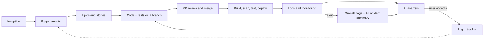
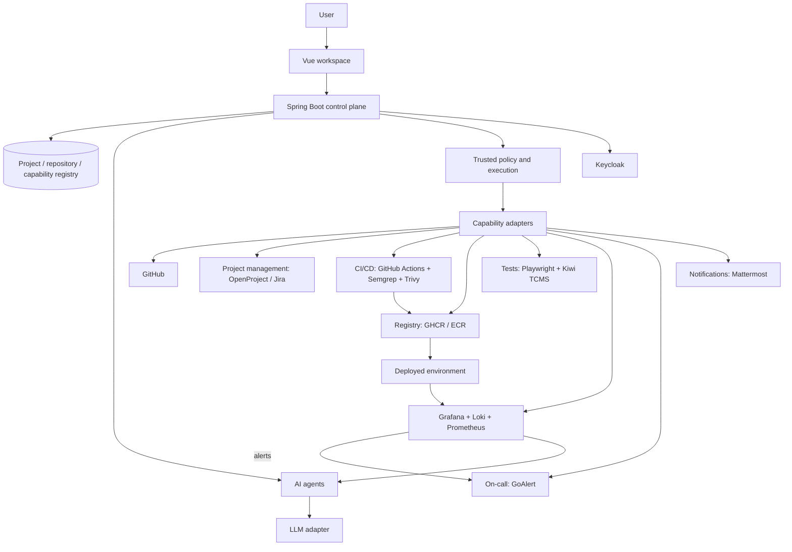

# UnityStack — Product Requirements Document

**Product:** UnityStack — Enterprise AI Software Factory  
**Document type:** Product Requirements Document (PRD), single current-state version  
**Version:** 2.1 (tool and architecture decisions)  
**Status:** Draft for review  
**Date:** 27 November 2026  
**Owner:** Partha Sarathi Ghosh  

---

## 1. About this document

This version replaces the stacked v1.1, v1.2 and v1.3 drafts with one current-state document. Earlier versions remain in Git history; Appendix A maps old sections to new ones.

- **Requirement IDs are stable.** Every FR-001 to FR-108 ID from earlier versions is kept, so existing references stay valid. New requirements start at FR-109. IDs are grouped by area in §13 rather than by the version that introduced them.
- **Priorities have been reset** to match the product decisions in §3 (see §6 for what P0, P1 and P2 now mean).
- **"GitHub" means the connected Git provider.** GitHub is the first Git provider adapter (AD-4). Where this document says GitHub, PR or GitHub App, read the equivalent in the connected provider (for example a GitLab merge request) unless it names a GitHub-only feature.
- **Detailed design** (C4 diagrams, API schemas, Terraform modules, threat models) belongs in separate HLD and ADR documents, linked from Git.
- Inception (§10) is the only area currently specified at the slice level. Other areas will gain slice-level detail as they are built.

## 2. Product summary

UnityStack is an AI-first, Git-driven software delivery platform. It covers the whole lifecycle — requirements, planning, code and tests, review, deployment, monitoring and feedback — and links every step with one shared change identifier.

People work with AI through a two-pane workspace: a conversation on the left and a live, read-only preview of the artifact on the right. The AI proposes; a person finalises; GitHub pull requests and policy govern what becomes approved. Teams can also work entirely in their own tools, and UnityStack observes and links that work without blocking it.

Every external tool, and the AI model itself, sits behind an adapter, so any of them can be swapped without changing the product.

**Guiding statement:** *From requirements to production. Powered by AI. Governed by humans.*

## 3. Settled product decisions (27 November 2026)

| # | Question | Decision |
|---|---|---|
| PD-1 | Primary user for the next 6–12 months | **The founder as sole user and developer, dogfooding.** UnityStack is built with UnityStack. Later, free demos with a few developers or organisations; enterprise buyers after that. Enterprise needs (installer, SSO, HA, onboarding, backfill) stay as direction, not current design constraints. |
| PD-2 | Bundle or connect | **Adapters everywhere.** Every SDLC tool and the LLM are reached only through an adapter. The selected open-source tools (§8.3) are the default providers, chosen because they are open source; alternatives such as Jira, or a different model, must be swappable. Bundling the default tools into an installer is a later packaging concern, not the product core. |
| PD-3 | Product core | **The closed loop, joined by one shared ID.** Requirement → stories → code and tests on a branch → PR review → deployment → logs and monitoring → AI-assisted problem detection → accepted bug back in the tracker → next change. AI drafting, traceability and the full lifecycle go hand in hand; none is built in isolation. |
| PD-4 | Delivery approach | **Thin loop first.** Build every stage of the loop in a basic form from end to end, with the Change ID in place from day one, then deepen each stage. See §6 and §17. |
| PD-5 | Tool selection | **Open source by default, every tool behind an adapter.** Default providers for each capability are listed in §8.3. Changing a provider must only mean adding or switching an adapter and its configuration. Later, an organisation picks the provider for each capability when UnityStack is installed. |

### 3.1 Architecture decisions (27 November 2026)

| # | Decision |
|---|---|
| AD-1 | **Java only for now.** AI logic stays in Java (Spring Boot application), not a separate Python service. It lives in its own module behind clean interfaces, with plain data objects in and out and no Spring-specific code inside, so that it can later be moved to a Python service (with AI help) without touching the rest. |
| AD-2 | **Local Docker until the thin loop works, then AWS as soon as possible.** All tools run in Docker Compose, grouped by Compose profiles so only what is needed is started. Once the loop works end to end, move to AWS (Terraform, EC2 + Docker Compose). Moving only the heavy tools to one EC2 host first is an allowed middle step. |
| AD-3 | **Keycloak from the start.** Keycloak handles sign-in, users, groups and broad roles; UnityStack checks project-level permissions. No temporary built-in login. |
| AD-4 | **Git provider behind an adapter.** Source control, branches and pull requests are a capability like any other. GitHub is the first adapter; Bitbucket, GitLab, Azure DevOps Repos and the fully open-source Gitea follow as further adapters. With Gitea, an organisation can run the whole stack on open source. |

## 4. Product principles

1. **AI-first, not AI-only.** UnityStack-native artifacts are created and revised through AI conversation; there are no manual authoring forms in the MVP. Editing in external tools, IDEs and GitHub is always allowed.
2. **AI proposes, humans govern.** The user explicitly finalises every AI proposal. GitHub branch protection, required checks and policy decide what merges and deploys. A successful AI response or test run is never a substitute for required human approval.
3. **The Git provider owns Git state.** The connected Git provider (GitHub first) is authoritative for repositories, branches, commits, PRs, reviews and merged artifacts. Each connected tool is authoritative for its own native records. UnityStack owns conversations, drafts, orchestration state, indexes and trace links.
4. **Adapters everywhere.** Workflows and agents call logical capabilities (for example `projectManagement.createStory`), never a provider's API directly. The LLM is a capability like any other.
5. **Your data stays yours.** Context lives in UnityStack's store, Git and the connected tools — never only inside a model provider. Switching model means the new model is fed the same context from those stores.
6. **One ID through the loop.** A stable Change ID links requirement, story, ADR, branch, commit, PR, test, build, deployment, log evidence and bug.
7. **Traditional SDLC remains valid.** Work done entirely outside UnityStack is observed and linked, never blocked.
8. **Walking skeleton and continuous delivery.** A deployable Hello World comes first; everything grows through small governed changes.
9. **Everything durable as code.** Requirements, ADRs, diagrams, API specs, code, tests, pipelines and infrastructure are Git artifacts. Runtime state, logs, metrics, secrets and tool databases are not.
10. **One reusable workspace, many modules.** Chat, preview, diff, revision, finalise and PR mechanics are shared; agents and renderers vary by role.

## 5. Users and roles

**Now:** one person (the founder) plays every role below, using UnityStack to build UnityStack.

**Later:** each role can be a different person, and an organisation can require that the reviewer is not the author.

| Role | Responsibility |
|---|---|
| Organisation administrator | Configure UnityStack, connected tools, policies and access |
| Product owner / business analyst | Shape requirements, epics, stories and priorities |
| UX designer | Review wireframes and UX artifacts |
| Solution architect | Review architecture, ADRs and API contracts |
| Developer | Discuss requirements, review and implement code and tests |
| Reviewer | Review and approve PRs |
| QA engineer | Review tests and quality evidence |
| DevOps / SRE | Manage pipelines, environments, releases, monitoring and incidents |
| AI agent | Propose artifacts and actions only within granted permissions |

## 6. Scope and releases

Priorities in this document mean:

| Priority | Meaning |
|---|---|
| **P0 — MVP** | Needed for the thin closed loop, used by the sole user (PD-1, PD-3). |
| **P1 — Next** | Deepens the loop while dogfooding and prepares for a small group of demo users. |
| **P2 — Later** | Enterprise distribution and adoption: installer, full default-tool bundle, BYOT selection, SSO, HA, large-scale ingestion. |

### 6.1 MVP (P0) — the thin closed loop

- Project Inception (§10) — **built**.
- Requirements workspace: AI edits a Markdown requirements document read from GitHub, with preview, diff, revisions, finalise → PR.
- Planning: AI decomposes approved requirements into epics and stories; after merge they are published to the project-management tool through its adapter.
- Development: AI proposes code **and tests together** for a story, on a branch, as a PR that carries the Change ID.
- Review and merge through GitHub, with UnityStack reflecting PR status.
- Delivery: GitHub Actions builds, runs unit tests (JUnit, Vitest), static code scanning (Semgrep) and dependency/image/secret scanning (Trivy), pushes the image to GitHub Container Registry and deploys the managed application (starting with Hello World) to the local Docker environment.
- Testing: end-to-end tests with Playwright; test cases kept in Git and each run's results recorded in Kiwi TCMS, linked to requirements, release and Change ID.
- Observe: the deployed application's logs (Loki) and metrics (Prometheus) are collected and viewable in Grafana and from UnityStack; the user can ask AI to analyse them.
- Feedback: AI can propose a bug from log evidence; once the user accepts it, the bug is created in the tracker, linked to the Change ID, and enters the loop again.
- Sign-in and roles through Keycloak (AD-3).
- Adapters for every tool used above, plus the LLM adapter with a mock provider.
- Change ID created at the start and carried through every stage.
- Everything runs locally in Docker Compose, using profiles (AD-2).

### 6.2 Next (P1)

- **Move to AWS** as soon as the thin loop works: Terraform, EC2 + Docker Compose, HTTPS, Amazon ECR adapter (AD-2).
- Black-box security testing of the deployed application with OWASP ZAP.
- Alerting and on-call: Grafana alerts page the on-call developer through GoAlert; at the same time AI investigates logs and metrics and adds a summary to the incident.
- Notifications (review requests, alerts, incident summaries) through Mattermost.
- Feature flags through OpenFeature, with Unleash as the provider.
- Second provider behind an existing adapter (Jira for project management) to prove swappability.
- Architecture workspace (HLD, ADRs, Mermaid) and richer previews.
- Passive observation of work done outside UnityStack, webhook reconciliation and bounded history import.
- My Work queues, workflow orchestration with parallel work and dependencies.
- Multi-user roles and resource permissions ready for demo users.
- Model routing, budgets, RAG over project documents, agent evaluation.

### 6.3 Later (P2)

- Versioned, installable distribution with Terraform-provisioned AWS, the full default tool profile, upgrade, backup and restore.
- Bring Your Own Tool: the organisation picks the provider for each capability at install time (for example GitHub Container Registry, ECR or Harbor; GitHub Actions, Jenkins or Argo CD; Mattermost, Slack or Teams).
- **AI meeting assistant:** an AI participant in requirement meetings that listens, asks questions, suggests solutions, summarises on request and later proposes requirement updates as PRs (§13.15).
- Enterprise onboarding: connect existing tools, historical backfill, relationship reconstruction, completeness reports.
- Full SSO across all tools, HA, Kubernetes, multi-cloud, cross-repository change sets.

### 6.4 Explicit exclusions from the MVP

Manual artifact editors inside UnityStack; installing all default tools; cloud deployment (comes straight after, in P1); enterprise installer; SSO across every third-party tool; high availability; multi-tenant SaaS; multi-cloud; autonomous production deployment; atomic cross-repository merges; advanced visual diagram diffs; large-scale historical ingestion.

## 7. The closed loop



| Stage | What happens | Human control point | Authority |
|---|---|---|---|
| Inception | AI captures the project charter (§10) | User confirms the charter | UnityStack, then Git once a repository is linked |
| Requirements | AI drafts and revises requirement documents | User finalises a revision → PR | Git |
| Planning | AI proposes epics, stories and acceptance criteria | User finalises → PR; after merge, published to the tracker | Git for the approved definition; tracker for operational status |
| Development | AI proposes code and tests together for a story | User finalises → PR | Git |
| Review | PR reviewed and merged under repository policy | Reviewer / policy | GitHub |
| Delivery | CI builds, scans (SAST, dependencies, images, secrets), tests, publishes the image and deploys; later a DAST scan runs against the deployed app | Environment protection, release policy, failing scans or tests block per policy | CI/CD system; test results in the test-management tool |
| Observe | Logs and metrics collected, tagged with service version and Change ID | — | Monitoring system |
| Alert (P1) | An alert pages the on-call developer; AI investigates and adds a summary to the incident | On-call developer acknowledges | On-call tool |
| Analyse | User asks AI about behaviour in an environment; AI answers with log evidence | — | UnityStack (analysis is derived, not authoritative) |
| Feedback | AI proposes a bug with evidence | User accepts → bug created in tracker | Tracker |

**Rules:** each stage can be done outside UnityStack and still be linked (§11). AI never advances a stage on its own: transitions come from user actions, policy and verified source events.

## 8. Adapter architecture

### 8.1 Capabilities and adapters

- Workflows and agents call **logical operations** on a capability, for example `projectManagement.createStory`, `scm.openPullRequest`, `ci.getRunStatus`, `observability.queryLogs`, `llm.complete`.
- An **adapter** translates those operations to one provider's API. Provisioning a tool and connecting to an existing instance are separate adapter concerns.
- A **capability registry** records, for each capability in each installation: provider ID, connection mode (provisioned or existing), endpoint, credential reference, supported operations, health and scope.
- Unsupported or edition-restricted operations return an explicit "unsupported operation" error; callers must handle it.
- MVP needs one working provider per capability used in the loop. The interfaces must not leak provider-specific concepts, so that a second provider can be added without changing workflows.
- **Swap rule:** changing the provider of a capability means adding or selecting an adapter and changing configuration — nothing else in UnityStack changes (NFR-015).
- **Selection:** today the provider is chosen in configuration. Later, an organisation chooses the provider for each capability at install time, and the installer deploys or connects only those (FR-043, FR-060).
- Where a provider already has a standard client abstraction, the adapter may use it (for example OpenFeature for feature flags, OpenID Connect for identity). Where an MCP server exists for a tool, an adapter may call it, subject to the trusted execution rules (§14); community MCP servers are checked for maturity before use.

### 8.2 LLM adapter and model-independent context

- The LLM is reached only through a provider-neutral interface (today: `InceptionAgent` with mock and OpenAI implementations). Provider and model are chosen by configuration.
- A **mock provider** is always available for offline development and automated tests.
- All context an agent needs — conversation, charter, drafts, approved artifacts, decisions, trace links — is stored in UnityStack, Git or the connected tools. Nothing depends on provider-side memory, threads or assistants.
- Switching provider or model takes effect for the next agent turn. The new model is given context rebuilt from those stores, so in-progress work continues.
- Every agent run records the provider and model used (`agentRef`, for example `openai:gpt-4.1-mini`) for audit.
- **Portable AI module (AD-1):** agents, prompts and LLM adapters live in a separate module of the Java code base. The module exposes interfaces with plain data objects (no framework or persistence types), contains no Spring-specific code, and is called by the rest of the application only through those interfaces. This keeps a later move to a separate (for example Python) AI service a contained change (NFR-016).

### 8.3 Capabilities and default providers

| Capability | Default (open source) | Alternatives to support later | Needed for MVP loop |
|---|---|---|---|
| Source control and PRs | GitHub (first adapter) | Gitea (open source), GitLab, Bitbucket, Azure DevOps Repos (P2) | Yes |
| LLM | Configurable (mock, OpenAI) | Any provider via the adapter; routing gateway such as LiteLLM (P1) | Yes |
| Identity and access | Keycloak | Azure AD / Entra ID, Okta through Keycloak federation or own adapter (P2) | Yes |
| Project management (epics, stories, bugs) | OpenProject | Jira (P1), Plane (P2) | Yes |
| CI/CD | GitHub Actions | Jenkins, Argo CD (P2) | Yes |
| Artifact (container) registry | GitHub Container Registry | Amazon ECR (P1, with the AWS move), Harbor (P2) | Yes |
| Static code security scanning (SAST) | Semgrep (community edition) | SonarQube security rules, others (P2) | Yes |
| Dependency, image, IaC and secret scanning (SCA) | Trivy | OWASP Dependency-Check, GitHub scanning (P2) | Yes |
| Dynamic / black-box security testing (DAST) | OWASP ZAP | — | P1 |
| Unit tests | JUnit (Java), Vitest (Vue) | — | Yes |
| End-to-end tests | Playwright | — | Yes |
| Test management (cases, runs, reports) | Kiwi TCMS | — | Yes |
| Logs | Loki | — | Yes |
| Metrics | Prometheus | — | Yes |
| Dashboards and alert rules | Grafana | — | Yes (dashboards); P1 (alerts) |
| On-call paging and escalation | GoAlert | Opsgenie, PagerDuty, OneUptime (P2) | P1 |
| Feature flags | OpenFeature with Unleash | Flagsmith or an organisation's own provider via OpenFeature (P2) | P1 |
| Notifications and team chat | Mattermost | Slack, Microsoft Teams (P2) | P1 |
| Meetings (AI meeting assistant) | *To be selected, for example Jitsi Meet or Mattermost calls* | Zoom, Teams (P2) | P2 |
| Architecture diagrams | Mermaid (library) | — | P1 |
| Technical documentation | MkDocs | Confluence (P2) | P1 |
| API documentation | Swagger UI | — | P1 |
| Code quality | SonarQube Community Build | — | P1 |
| Initial wireframes | Excalidraw | — | P2 |
| UX/UI design | Penpot | — | P2 |
| Software catalogue | Backstage | — | P2 |
| Web IDE | Eclipse Theia | Local IDE (always) | P2 |

The nine originally selected tools are OpenProject, Excalidraw, Penpot, Mermaid, MkDocs, Backstage, Swagger UI, Eclipse Theia and SonarQube Community Build. On 27 November 2026 the default set was extended to cover the remaining SDLC gaps: identity, CI/CD, artifact registry, security scanning, testing, observability, alerting and on-call, feature flags and notifications. All defaults are open source; Semgrep and Unleash have paid editions whose extra features are not required.

Notes on how the new tools fit together:

- **Semgrep vs Trivy:** Semgrep reads UnityStack's own code for risky patterns (for example injection or unsafe input handling). Trivy checks what the code depends on: library versions, container images, infrastructure misconfigurations and leaked secrets. Both are needed.
- **Grafana, Loki, Prometheus:** Loki stores logs, Prometheus stores metrics, Grafana shows both and evaluates alert rules.
- **GoAlert:** on-call rotations (daily, weekly, hourly), temporary overrides and escalation policies; pages by phone call or SMS. Its API allows UnityStack to manage rotations later.
- **Kiwi TCMS:** test cases, test plans, test runs per build or release, and reports such as requirements without tests. Test cases are authored in Git (by AI, reviewed by PR); Kiwi keeps run history so every release has a permanent record of what was tested and what passed.
- **OpenFeature with Unleash:** Unleash is the flag server and dashboard; OpenFeature is the standard SDK the code calls. An organisation with its own flag system writes an OpenFeature provider and plugs it in without UnityStack code changes.

**Important:** an available provider does not imply full integration, SSO or feature parity. Each adapter documents its supported operations, versions, licensing and limitations.

## 9. AI workspace model

- **Two panes:** left, the AI conversation (questions, clarifications, progress, references); right, a continuously refreshed read-only preview. Narrow screens may stack the panes without losing either.
- **Role-specific previews:** requirements → BRD/PRD Markdown; planning → epic/story hierarchy; architecture → HLD, ADRs, rendered Mermaid and source diff; development → changed files and code diff with build/test feedback; testing → test cases and results; delivery → build, release and deployment state; observe → log excerpts and AI findings.
- **Revisions:** every AI proposal creates a draft revision with an immutable ID, timestamp, actor, agent-run reference, source baseline (Git commit SHA where applicable) and parent revision. The preview offers current, diff and history views. An accepted draft is never overwritten silently.
- **Draft lifecycle:** `OPEN → PROPOSED → USER_ACCEPTED → PR_OPEN → MERGED`, or `REVISE / REJECT / CLOSED`. PR and merge states are read from GitHub, not inferred from chat.
- **Finalisation:** the user explicitly accepts a specific revision; trusted code validates schema, permissions and destination before creating the branch, commit and PR. Finalising does not merge.
- **Conflicts:** if the upstream baseline changed since the draft started, show the conflict and offer rebase or restart; never overwrite.
- **Manual editing:** none inside UnityStack in the MVP. External editors, IDEs and GitHub remain available. An "open in editor" action is P2.

## 10. Project Inception — AI-led project creation (built)

**Purpose:** capture a new project's very high-level intent through a short AI conversation instead of a form. Inception is deliberately simple; features, modules and detailed requirements are discovered later in the requirements and planning workspaces.

### 10.1 User journey

1. A signed-in user clicks **New Project**.
2. UnityStack opens the two-pane workspace: AI conversation on the left, live read-only **Project Charter** preview on the right.
3. The AI asks adaptive questions, one (or two closely related) at a time, skipping anything already answered.
4. When all mandatory items are captured, the workspace shows **Ready to create**; the AI presents a summary for confirmation.
5. The user explicitly confirms; UnityStack creates the project and offers next steps: connect or create a GitHub repository and start the requirements workspace.
6. If the user leaves before confirming, the inception conversation is discarded and nothing is created.

### 10.2 Information captured

| Item | Mandatory | Example prompt |
|---|---|---|
| Project name | Yes | "What should we call this project?" |
| Problem statement | Yes | "What problem will it solve?" |
| Target users | Yes | "Who will use it?" |
| Product type | Yes | "Is it a website, mobile app, API/backend, desktop app, internal tool, data/AI product, or something else?" (with follow-ups, e.g. iOS/Android/both) |
| Expected benefit | Yes | "Once this exists, what will be better for its users or the business?" (no metrics needed) |
| Scale | Yes | "How big is this: a personal or team tool, one department, the whole organisation, or public?" (one of: personal, team, department, organisation, public) |
| Why now / motivation | No | "Why is this needed now?" |
| Constraints | No | Deadline, budget, compliance, technology preferences, systems it must connect to |
| Out of scope | No | "Is there anything this project should definitely not do?" |

- Target length: about 8–10 questions; the user may create the project as soon as mandatory items are covered.
- "I don't know" is a valid answer and is recorded as an open question.
- The AI does **not** propose features or modules at inception; it records only what the user provides.
- Measurable success targets (KPIs) are **not** asked at inception, because they are hard to define this early. They are captured later in the requirements workspace, building on the expected benefit.

### 10.3 Data and ownership

- On confirmation, UnityStack stores in PostgreSQL: the project record (ID, short key, name, status, product type, creator, timestamps), the charter as structured data plus rendered Markdown, open questions, and the inception conversation with agent-run reference.
- The charter is versioned: each change creates a new revision with parent revision, actor and agent-run reference.
- Until a GitHub repository is linked, PostgreSQL is authoritative for the charter. When a repository is linked or created, UnityStack proposes the current charter to the mapped Git path through a PR; after merge, Git is authoritative and later changes follow the normal draft → finalise → PR flow.
- After creation, charter content changes through AI conversation. Project name, key and status may also be changed in a simple project settings panel; those changes are audited.

The requirements for this slice are FR-102 to FR-108 in §13.11.

**Acceptance:** a user creates a project by answering only the mandatory questions; the project and charter revision 1 exist in PostgreSQL; abandoning a second inception leaves no project; renaming the project creates an audit record.

## 11. Source authority, sync and coexistence

- **UnityStack is never a mandatory gateway.** A team can create stories in the tracker, code in a local IDE, open and merge PRs in GitHub, run CI/CD and deploy without opening UnityStack.
- **Authority:** the connected Git provider (GitHub first) owns repository, branch, commit, PR, review and merge truth. The tracker owns ticket and status records. CI/CD owns build and deployment execution. The monitoring system owns logs and metrics. UnityStack owns orchestration state, AI drafts, indexes, correlations and inferred links.
- **Artifact mapping record:** stable artifact ID, type, owning repository/path/branch, canonical format, originating tool, sync direction, last synced commit, tool revision and sync status.
- **Canonical lifecycle:** Draft → Validate → Proposed PR → Review → Merge → Synchronise connected tools → Verify.
- **Field-level ownership:** native tool edits are allowed. Operational fields (for example tracker status) belong to the tool; Git-approved fields (for example acceptance criteria) belong to Git. Drift is reported, never silently overwritten; conflicts show both versions and a resolution path.
- **Ingestion:** webhooks where available, API polling, checkpoints and scheduled reconciliation. Duplicate and out-of-order events are handled idempotently. Ingesting never modifies the source record.
- **Unlinked work:** PRs or stories without a matching Change ID are kept and shown; UnityStack may suggest links but never fabricates them or blocks the work.
- **Idempotency:** idempotency keys and optimistic revision checks prevent duplicate PRs, duplicate tracker items and replayed updates. Failed publication is visible, retryable and audited, and an unmerged proposal is never treated as approved.
- **Limits:** UnityStack cannot reconstruct records deleted before ingestion, outside granted access, not exposed by APIs or expired under the source's retention. It promises best-effort capture of accessible data and transparent gap reporting, not zero data loss.

## 12. Traceability and Change ID

- Every UnityStack-initiated change gets a stable **Change ID** at the start of the loop (format to be decided — see D-4; for example `<PROJECTKEY>-CHG-001`).
- The Change ID is carried through: requirement and story IDs, branch name, commit trailer, PR title or label, CI run metadata, build and image version, deployment record, structured log fields, and bug records.
- External work keeps its own source IDs (tracker key, PR number, commit SHA) even when no Change ID exists yet.
- **Verified links** come from explicit references (an ID in a branch, commit, PR or ticket). **Inferred links** proposed by AI are labelled with confidence and evidence and stay unverified until a person confirms them.
- Runtime tracing IDs (for example OpenTelemetry `trace_id`) are distinct from the Change ID and are correlated through service version and deployment metadata.
- Goal: one end-to-end timeline per Change ID, reproducible from stored provenance, with missing links shown as gaps rather than filled in.

## 13. Functional requirements

IDs are stable (see §1). "Was" shows the earlier priority where it changed.

### 13.1 Adapters and capability registry

| ID | Priority | Requirement |
|---|---|---|
| FR-109 | P0 | **New.** Every external tool is accessed only through a capability adapter; workflows and agents contain no provider-specific API calls. |
| FR-042 | P0 | Provide a capability registry and stable provider-independent interfaces for every capability used in the MVP loop. |
| FR-050 | P0 | The registry maps logical operations to installed or connected provider adapters, with endpoint, credential reference, supported operations and health. |
| FR-005 | P0 | Show each configured tool in the UnityStack portal with endpoint, connection mode and health. *(Was: show all nine installed tools.)* |
| FR-127 | P2 | **New.** Support further Git providers behind the source-control adapter (Gitea, GitLab, Bitbucket, Azure DevOps Repos), mapping branches, commits, pull/merge requests, reviews, branch protection and webhooks; operations a provider lacks return an explicit unsupported-operation error. |
| FR-112 | P1 | **New.** Add Jira as a second project-management provider behind the same adapter, proving that the provider can be swapped without workflow changes. |
| FR-043 | P2 | Allow each capability to use a UnityStack-provisioned default, an existing customer instance, or a supported alternative provider, chosen by the customer. |
| FR-060 | P2 | Allow users to select an alternative provider, connect an existing enterprise instance, or provision a supported alternative per capability (BYOT) through the UI. |

### 13.2 LLM adapter and AI control plane

| ID | Priority | Requirement |
|---|---|---|
| FR-026 | P0 | Provide an LLM adapter that switches model provider and model by configuration, with no workflow changes. |
| FR-110 | P0 | **New.** Always provide a mock LLM provider for offline development and automated tests. |
| FR-111 | P0 | **New.** Keep all agent context in UnityStack, Git or connected tools; after a provider or model switch, the next agent turn receives context rebuilt from those stores, with no dependency on provider-side memory. |
| FR-027 | P0 | Provide an AI business-analyst workflow that turns conversation into structured requirements-as-code. |
| FR-028 | P0 | Separate AI reasoning and requested actions from trusted identity, authorisation, validation, approval and tool execution. |
| FR-029 | P0 | Enforce configured reviewer approval for merges (review may be optional where permitted), mandatory policy and quality gates, and separately configured production deployment authorisation. User finalisation of an AI proposal is always explicit. |
| FR-030 | P0 | Record agent execution state, provider and model, failures, retries and tool-call audit events. |
| FR-031 | P0 | Add role agents progressively: requirements, planning, developer (code and tests), and observe/analyse agents are needed for the MVP loop; UX, architecture and operations agents follow. *(Was P1.)* |
| FR-032 | P1 | Introduce MCP-based tool integration where it adds value, with controlled permissions and validation. |
| FR-033 | P1 | Add RAG over authorised project documents, agent evaluation, and model cost and latency tracing. |
| FR-034 | P1 | Enforce retry limits, budgets, timeouts and human escalation for failed or ambiguous agent actions. |

### 13.3 AI workspaces and revisions

| ID | Priority | Requirement |
|---|---|---|
| FR-071 | P0 | Use AI conversation and a read-only live preview for all UnityStack-native artifact creation. |
| FR-093 | P0 | Provide role-specific two-pane workspaces on a common preview and revision framework. |
| FR-094 | P0 | Record revision history and show differences for each supported MVP artifact type. |
| FR-020 | P0 | Show the proposed artifact and diff before publication or approval. |
| FR-064 | P0 | Apply conversational revisions to versioned previews and show inline or structured diffs. |
| FR-065 | P0 | Require explicit user finalisation of a specific draft revision before creating a GitHub PR. |
| FR-077 | P2 | Offer launch-in-browser or local editor for manual artifact changes. |
| FR-078 | P2 | Optionally support direct artifact editing inside UnityStack. |

### 13.4 Requirements and planning

| ID | Priority | Requirement |
|---|---|---|
| FR-061 | P0 | Support conversational discovery and clarification of business requirements. |
| FR-062 | P0 | AI recommends story count, epic grouping, acceptance criteria and dependencies based on scope. |
| FR-063 | P0 | Show hierarchical epic/story and partial or full BRD previews. |
| FR-068 | P0 | After merge, publish approved epics and stories to the project-management tool through its adapter. *(Was: to OpenProject.)* |
| FR-069 | P0 | Make publication retryable and idempotent; no duplicate stories after retries or outages. |
| FR-070 | P0 | Show proposal → PR → merge → tool publication status and failure reasons. |
| FR-036 | P0 | Integrate the project-management adapter enough to link requirements and work items with Git-backed artifacts; document sync ownership and conflict handling. |

### 13.5 Development, tests and Git lifecycle

| ID | Priority | Requirement |
|---|---|---|
| FR-116 | P0 | **New.** For a story, the developer agent proposes code changes and matching tests together, on a branch, after reading the linked requirement, story, ADRs and repository conventions. |
| FR-018 | P0 | Treat approved GitHub content as the canonical version of durable, reviewable SDLC artifacts. |
| FR-019 | P0 | AI-generated changes are made on branches and proposed through PRs; no direct AI push to protected branches. |
| FR-021 | P0 | Validate generated artifacts against schemas and project rules before creating a PR. |
| FR-022 | P0 | Preserve actor, prompt/run reference, source requirement, artifact version, PR URL and approval status for audit. |
| FR-066 | P1 | Support configurable optional additional reviewer approval per organisation or repository. *(Sole user for now; see D-7.)* |
| FR-067 | P1 | Permit automatic merge only where policy and branch protection allow and all required checks pass. *(Was P0.)* |
| FR-024 | P1 | Detect and reconcile changes made directly in connected tools to prevent uncontrolled divergence from Git. |
| FR-025 | P2 | Coordinate multi-repository changes without assuming atomic cross-repository merges. |
| FR-017 | P2 | Track related PRs across repositories as a logical change set with dependencies and merge status. *(Was P1.)* |
| FR-058 | P2 | Support dependency-aware multi-repository change sets with explicit handling of partial merges. *(Was P1.)* |

### 13.6 Delivery

| ID | Priority | Requirement |
|---|---|---|
| FR-097 | P0 | Deploy a Hello World walking skeleton through an automated pipeline to a production-designated environment. |
| FR-044 | P0 | Version tests, CI/CD pipelines, deployment configuration and monitoring configuration in Git. *(Was P1.)* |
| FR-045 | P0 | Run validation and deployment through trusted pipelines with environment protection. *(Was P1.)* |
| FR-117 | P0 | **New.** Run static code security scanning (SAST) and dependency, image, infrastructure and secret scanning (SCA) in CI on every PR; link findings to the PR and Change ID; failing scans block merge according to policy. |
| FR-118 | P1 | **New.** Run dynamic black-box security testing (DAST) against the deployed application after deployment; link findings to the deployment and Change ID, and let AI propose bugs from them (FR-115). |
| FR-119 | P0 | **New.** Publish built images to the artifact registry through its adapter, tagged with version, commit SHA and Change ID. |
| FR-120 | P0 | **New.** Keep test cases in Git, record every test run's results (unit, end-to-end, manual) in the test-management tool against the build or release, and link them to requirement, story and Change ID; provide a per-release test report kept in history. |
| FR-121 | P1 | **New.** Control feature exposure through feature flags reached via the OpenFeature SDK, with per-environment settings; flag changes are audited. |
| FR-098 | P1 | Support configured automatic delivery or human production release approval with quality gates. |
| FR-041 | P1 | Bring code-quality results (SonarQube) and IDE workflows into PR review. |

### 13.7 Observe, analyse and feedback

| ID | Priority | Requirement |
|---|---|---|
| FR-113 | P0 | **New.** The deployed application emits structured logs (and basic metrics) tagged with service version and Change ID; they are collected by the observability provider and viewable from UnityStack. |
| FR-114 | P0 | **New.** The user can ask AI to analyse logs for an environment and time window; the AI's findings cite the log entries they are based on. |
| FR-115 | P0 | **New.** AI may propose a bug from its findings; the bug is created in the tracker only after a person accepts it, and is linked to the Change ID, deployment and log evidence. |
| FR-046 | P0 | Connect production signals to incident or improvement proposals that re-enter the governed loop. *(Was P1.)* |
| FR-122 | P1 | **New.** Route alerts from alert rules to the on-call tool, which pages the on-call developer (phone, SMS, app) using rotations, overrides and escalation policies. |
| FR-123 | P1 | **New.** When an alert fires, notify UnityStack as well; AI investigates the related logs and metrics and attaches a summary with cited evidence to the incident while the developer is being paged. Any resulting bug still needs a person to accept it (FR-115). |
| FR-124 | P1 | **New.** Send notifications (review requests, PR status, alerts, incident summaries, publication failures) through a notification adapter. |

### 13.8 Traceability and Change ID

| ID | Priority | Requirement |
|---|---|---|
| FR-099 | P0 | Assign persistent Change IDs and propagate them through artifacts, branches, commits, PRs, builds, deployments, logs and bugs. |
| FR-053 | P0 | Capture stable artifact IDs, Git commit/ref, source request and agent-run linkage for all generated artifacts. |
| FR-023 | P0 | Maintain traceability across requirement → design → code → tests → deployment → production feedback (thin, explicit links only). *(Was P1.)* |
| FR-056 | P0 | Support traceability links among requirements, architecture, APIs, implementation, tests, releases and operational feedback. *(Was P1; same scope as FR-023.)* |
| FR-047 | P0 | Link releases, deployments, quality results and incidents to commits and Change IDs. *(Was P1.)* |
| FR-100 | P0 | Correlate approved changes, releases, deployment versions, incidents and available runtime telemetry. *(Was P1.)* |
| FR-082 | P1 | Build cross-tool traceability across requirements, work items, PRs, tests, releases and incidents where evidence exists, including work done outside UnityStack. |
| FR-083 | P1 | Label AI-inferred associations separately from verified ones. |
| FR-089 | P2 | Reconstruct historical cross-tool traceability with evidence and explicit confidence. |

### 13.9 Coexistence, sync and ingestion

| ID | Priority | Requirement |
|---|---|---|
| FR-072 | P0 | Allow complete traditional SDLC work outside UnityStack with no dependency on its availability. |
| FR-079 | P0 | Allow end-to-end SDLC work without using the UnityStack UI. |
| FR-073 | P0 | Detect externally created or updated GitHub PRs, commits and branches. |
| FR-074 | P0 | Synchronise PR review, merge and available CI/CD status into UnityStack's derived state. |
| FR-075 | P0 | Link external records to Change or story IDs using source-backed identifiers and evidence. |
| FR-084 | P0 | Preserve source-system authority, stable source IDs, URLs, timestamps and sync status. |
| FR-092 | P0 | Preserve source authority, identity, timestamps and provenance in imported records. |
| FR-051 | P0 | Assign canonical ownership and sync direction to each artifact type and tool; detect divergence and block silent overwrites. |
| FR-076 | P1 | Keep unlinked external work and optionally suggest relationships without blocking it. *(Was P0.)* |
| FR-080 | P1 | Passively ingest external SDLC events and periodically reconcile source records. *(Was P0.)* |
| FR-091 | P1 | Provide an ongoing sync and reconciliation foundation for connected providers. *(Was P0.)* |
| FR-055 | P1 | Define durable events, idempotent handlers, retry and dead-letter behaviour and recovery for long-running workflows and webhooks. |
| FR-081 | P2 | Import available historical records from connected tools. *(Was P1.)* |
| FR-086 | P2 | Provide scoped initial import of accessible GitHub and tracker records. *(Was P1.)* |
| FR-087 | P2 | Support large-scale resumable incremental historical ingestion and backfill. |
| FR-088 | P2 | Connect existing enterprise providers (for example Jira, Jenkins, Confluence) through supported adapters. |
| FR-090 | P2 | Produce ingestion coverage, exceptions, provenance and reconciliation reports. |
| FR-085 | P2 | Support existing-organisation adoption alongside greenfield installations. *(Was P0; the adapter design in §8 keeps this possible.)* |

### 13.10 Workflow orchestration

| ID | Priority | Requirement |
|---|---|---|
| FR-095 | P1 | Generate actionable work items from approved workflow events; support parallel work and blocking dependencies. |
| FR-096 | P1 | Provide My Work assignment, pickup, review and exception queues. |
| FR-101 | P1 | Allow workflow recovery and replay without duplicate downstream actions or unauthorised transitions. |

### 13.11 Projects, repositories and Inception

| ID | Priority | Requirement |
|---|---|---|
| FR-102 | P0 | Any signed-in user can start a new project from a single entry point that opens an AI-led inception conversation; no creation form is provided. **Built.** |
| FR-103 | P0 | The AI captures mandatory items (name, problem, target users, product type, expected benefit, scale) through adaptive questioning, and records unknowns as open questions. **Built.** |
| FR-104 | P0 | Show a live read-only Project Charter preview that updates as answers are captured, with a readiness indicator. **Built.** |
| FR-105 | P0 | Create the project only after the user explicitly confirms a summarised charter; abandoned inception conversations are discarded. **Built.** |
| FR-106 | P0 | Persist the project, charter revisions, open questions and inception conversation with actor and agent-run references. **Built.** |
| FR-107 | P0 | Allow charter changes via AI conversation and name/key/status changes via a simple settings panel, each producing an audited revision. |
| FR-108 | P1 | When a GitHub repository is linked or created, propose the charter to Git via PR; after merge, treat Git as authoritative. |
| FR-011 | P0 | Support multiple projects within one UnityStack installation. |
| FR-012 | P0 | Register one or more GitHub repositories per project. |
| FR-014 | P0 | Map artifact types to repository, branch and path; agents resolve destinations through the registry, not hard-coded folders. |
| FR-013 | P1 | Support monorepo, multi-repo, repository-per-service and hybrid arrangements. *(Was P0.)* |
| FR-015 | P1 | Allow multiple repositories for the same artifact type. *(Was P0.)* |
| FR-016 | P2 | Support shared organisational repositories for standards, libraries and templates. *(Was P1.)* |

### 13.12 Identity and security

| ID | Priority | Requirement |
|---|---|---|
| FR-052 | P0 | All agent action requests pass through a trusted policy, authorisation and execution layer with scoped credentials and approval checks. |
| FR-049 | P0 | Provide central identity, session management and platform roles through the identity provider (Keycloak, AD-3); map platform identities to tool access where supported and document exceptions. |
| FR-125 | P0 | **New.** Enforce resource-level permissions: which user or role may perform which operation (for example view, edit, finalise, approve, deploy) on which resource (for example a project, artifact, PR or environment). The identity provider supplies identity, groups and broad roles; UnityStack evaluates project-level rules. |

### 13.13 Design and documentation tools

| ID | Priority | Requirement |
|---|---|---|
| FR-038 | P1 | Generate Mermaid diagrams and ADRs through human-reviewed PRs. |
| FR-039 | P2 | Publish Markdown documentation through MkDocs and OpenAPI specifications through Swagger UI. *(Was P1.)* |
| FR-037 | P2 | Generate and review Excalidraw wireframes and Penpot designs with Git-backed artifacts. *(Was P1.)* |
| FR-040 | P2 | Register software components in Backstage using Git-versioned catalogue descriptors. *(Was P1.)* |

### 13.14 Distribution and platform operations (Later)

| ID | Priority | Requirement |
|---|---|---|
| FR-001 | P2 | Deliver a versioned UnityStack distribution with infrastructure modules, deployment definitions, configuration templates and installer scripts. *(Was P0.)* |
| FR-002 | P2 | Accept organisation-specific cloud region, domain, GitHub organisation, AI provider and deployment profile settings. *(Was P0.)* |
| FR-003 | P1 | Use Terraform to provision required AWS resources with repeatable plan and apply workflows. *(Was P0; needed as soon as the thin loop works, AD-2.)* |
| FR-004 | P2 | A full installation profile deploys UnityStack and the default tool for every selected capability (§8.3), with their dependencies. *(Was P0.)* |
| FR-035 | P2 | Deploy and expose the default tools chosen at install time. *(Was P0.)* |
| FR-006 | P2 | Make installation idempotent where practical; rerunning must not destroy persistent data. *(Was P0.)* |
| FR-007 | P2 | Pin application and infrastructure versions in a release manifest. *(Was P0.)* |
| FR-008 | P1 | Provide backup and restore of UnityStack data, health checks and documented upgrade steps. *(Was P0.)* |
| FR-009 | P2 | Support optional core and custom installation profiles. |
| FR-010 | P2 | Provide scheduled drift checks, update recommendations and operational dashboards. |
| FR-048 | P2 | Separate platform installation/upgrade/recovery from the lifecycle of customer software, with separate versions, roles and audit records. *(Was P0.)* |
| FR-054 | P2 | Record installation phase outcomes, readiness failures, backup verification and repeat-deployment results in an inspectable report. *(Was P0.)* |
| FR-057 | P2 | Provide onboarding templates and validation for domain, region, repositories, identity, AI settings and tool endpoints. *(Was P1.)* |
| FR-059 | P2 | Provide cost and resource reporting and sizing profiles based on measured usage. *(Was P1.)* |

### 13.15 Future: AI meeting assistant

| ID | Priority | Requirement |
|---|---|---|
| FR-126 | P2 | **New.** An AI participant can join requirement meetings (with the participants' consent) through a meeting adapter; it listens, raises questions, suggests solutions when asked, produces a summary and transcript on request, and afterwards proposes requirement updates in the requirements workspace, which follow the normal finalise → PR flow. |

## 14. Security, identity and governance

1. AI output is attributable to an agent run (provider and model) and a source request.
2. Agents may draft but may not merge protected PRs, obtain unrestricted cloud credentials or deploy to production without the applicable policy and approval checks.
3. **Trusted action boundary:** the LLM proposes an action; non-LLM code checks policy, identity, target, schema, budget and approval before executing it.
4. **Identity model:** distinguish the human requester or approver, the logical AI agent, and the trusted execution service; record all three.
5. **Least privilege:** GitHub App with scoped permissions, short-lived credentials where available, separate read / propose / execute privileges.
6. **Untrusted input:** repository files, retrieved documents, tool output, issue text and **logs** are untrusted; instructions inside them never override system policy.
7. **Secrets** never go into Git or model prompts unnecessarily. Real keys live only in `.env` (git-ignored) locally, or a secrets manager when deployed; `.env.example` holds placeholders only.
8. **Sign-in from the start:** UnityStack uses Keycloak (OpenID Connect) even locally; any environment reachable from the internet must also use HTTPS. Keycloak realm configuration is exported to a file in Git (no secrets) so the local setup rebuilds the same way.
9. Sandboxed code execution, secret redaction, outbound access controls and emergency revocation are required as the developer agent matures.
10. Every adapter defines its authority, sync direction, conflict handling and audit events.

**Acceptance:** an AI agent cannot merge a protected PR, obtain an unrestricted cloud credential or deploy to production without the applicable policy and approval checks.

## 15. Architecture and deployment

### 15.1 Current implementation (as of 27 November 2026)

| Part | Implementation |
|---|---|
| Frontend | Vue 3 + Vite, served by nginx (`frontend/`) |
| Control plane | Java + Spring Boot (`backend/`), Flyway migrations |
| AI | Inside the Spring Boot backend, behind the provider-neutral `InceptionAgent` interface; mock and OpenAI implementations. Stays in Java (AD-1); to be moved into its own framework-free module. |
| State | PostgreSQL |
| Runtime | Local Docker Compose (PostgreSQL + backend + frontend) |
| Identity | Not yet; Keycloak to be added (AD-3) |
| Cloud | None yet; AWS after the thin loop works (AD-2) |

### 15.2 Target logical architecture



- **Control plane:** portal, API, registry, identity and policy, workflow state.
- **AI plane:** agents and the LLM adapter, in a separate framework-free Java module (AD-1); models hold no direct infrastructure permissions.
- **Integration plane:** capability adapters, optionally exposed via MCP behind trusted execution.
- **Data plane:** the Git provider (GitHub first) for canonical artifacts; PostgreSQL for application and workflow data; tool databases for tool data; the observability provider for logs and metrics.
- **Deployment plane:** CI/CD deploys the managed application; infrastructure as code provisions environments.

### 15.3 Runtime environments (AD-2)

**Now — local Docker Compose.** Every tool runs as a container from its official image; nothing is installed on the developer's machine. Services are grouped with Docker Compose profiles so only what is needed starts, for example:

| Profile | Services |
|---|---|
| `core` | PostgreSQL, backend, frontend, Keycloak |
| `pm` | OpenProject |
| `test` | Kiwi TCMS |
| `monitoring` | Grafana, Loki, Prometheus |
| `oncall` | GoAlert |
| `chat` | Mattermost |
| `flags` | Unleash |

`docker compose --profile core up` starts the everyday stack; adding `--profile monitoring` and others brings in the rest. Memory use is the main constraint on a laptop.

**Next — AWS, as soon as the thin loop works.** The same Compose files run on EC2 with minimal change, provisioned by Terraform. Allowed middle step: move only the heavy tools (for example monitoring, chat, test management) to one EC2 host while the app runs locally. Stop the instance when not in use to control cost. The ECR adapter is added alongside the AWS move.

**Later — enterprise.** See §15.5.

### 15.4 Artifact types and repository flexibility

UnityStack must not assume one repository or fixed folders.

| Artifact type | Typical Git representation |
|---|---|
| Requirements, epics, stories, bugs | Markdown / YAML |
| Wireframes | `.excalidraw` JSON |
| UX artifacts | Design exports, tokens, prototype source |
| Architecture | Mermaid, ADR Markdown |
| API contracts | OpenAPI YAML/JSON |
| Application code and tests | Source files |
| Infrastructure | Terraform / deployment manifests |
| CI/CD | GitHub Actions YAML |
| Observability configuration | Dashboard, alert and SLO definitions |
| Documentation | Markdown, `mkdocs.yml` |
| Catalogue metadata | `catalog-info.yaml` |

Illustrative repository registry (not a final schema):

```yaml
organization: abc-bank
project: digital-banking
repositories:
  - id: requirements
    provider: github
    repository: abc-bank/banking-requirements
    defaultBranch: main
    artifacts:
      - type: requirement
        path: requirements/
      - type: story
        path: stories/
  - id: customer-service
    provider: github
    repository: abc-bank/banking-customer-service
    defaultBranch: main
    artifacts:
      - type: source-code
        path: src/
      - type: unit-test
        path: src/test/
```

### 15.5 Later: enterprise distribution and onboarding (P2)

- **Distribution:** versioned package; Terraform-provisioned AWS (EC2 + Docker Compose first, EKS later); S3 remote state with locking; IAM least privilege and GitHub OIDC; Secrets Manager or SSM; ECR; TLS; pinned versions in a release manifest; installer, upgrade, validate and uninstall scripts; full default-tool profile with health checks.
- **Platform lifecycle:** install, configure, upgrade, rollback/recovery and uninstall are separate from the lifecycle of managed software; a platform upgrade never triggers a product release. Irreversible migrations are never promised automatic rollback.
- **Adoption modes:** greenfield (deploy with default tools) or existing organisation (connect existing tools, ingest accessible history, keep teams' own processes).
- **Onboarding steps:** discover and configure providers and permissions; connect with least privilege, read-only first; start event capture before or with backfill; import history in resumable batches; normalise records while keeping source IDs and provenance; build verified links, then optionally propose inferred ones; report completeness and gaps; enable steady-state sync and health alerts.
- **Tenancy:** one independent installation per organisation; multi-tenant SaaS only if later required.

## 16. Non-functional requirements

| ID | Category | Requirement |
|---|---|---|
| NFR-001 | Reproducibility | The same version and configuration produce functionally equivalent deployments. |
| NFR-002 | Security | Encrypt data in transit and at rest where supported; least privilege; protected secrets; audited administrative access. |
| NFR-003 | Isolation | Each organisation has its own installation, credentials, databases and resources. |
| NFR-004 | Extensibility | Integrations use stable capability contracts, never provider-specific logic in agents or workflows. |
| NFR-005 | Maintainability | Tool images and versions are pinned, documented and independently upgradeable where possible. |
| NFR-006 | Reliability | Failures are detected and reported; persistent data survives routine redeployments. |
| NFR-007 | Observability | Record platform health, errors, deployment outcomes and AI run metadata. |
| NFR-008 | Cost | Nonessential services can be switched off; cloud and LLM cost drivers are documented before larger deployments. |
| NFR-009 | Portability | Cloud-specific logic stays in infrastructure modules; provider-specific logic stays in adapters. |
| NFR-010 | Performance | Response-time and capacity targets are set after a baseline measurement. |
| NFR-011 | Recovery | Backup and restore of persistent data are documented and tested. |
| NFR-012 | Accessibility | Portal navigation and controls are accessible. |
| NFR-013 | Model independence | **New.** Switching LLM provider or model needs configuration only and loses no project context. |
| NFR-014 | Local-first development | **New.** The whole MVP loop can run locally with Docker and the mock LLM, without cloud resources. |
| NFR-015 | Replaceability | **New.** Changing the provider of any capability touches only that capability's adapter and configuration files. |
| NFR-016 | AI module portability | **New.** The AI module has no framework dependencies and exchanges only plain data objects, so it can be moved to a separate service in another language without changes elsewhere (AD-1). |
| NFR-017 | Resource footprint | **New.** Local services are grouped in Compose profiles; the everyday `core` profile runs comfortably on a developer laptop. |

Quantitative targets (install time, cloud spend, SLOs, RTO, RPO) are deliberately TBD until measured.

## 17. MVP acceptance — the thin loop

The MVP is accepted when the sole user can do the following on a demo application (Hello World first), with every step linked by one Change ID:

1. Create a project through Inception and link its GitHub repository; the charter is proposed to Git via PR.
2. Discuss a requirement change with AI, inspect the diff, finalise a revision and get a PR in the mapped repository.
3. After merge, have AI propose epics and stories; after their PR merges, they are published once to the tracker, even if events are replayed.
4. Pick a story; AI proposes code and tests together on a branch; the PR carries the Change ID.
5. Merge the PR under repository policy; CI builds, runs unit tests, Semgrep and Trivy, pushes the image to GitHub Container Registry and deploys to the local environment. A failing scan or test blocks the merge or deploy according to policy.
6. Playwright end-to-end tests run against the deployed version, and the run's results are recorded in Kiwi TCMS against the release, linked to the requirement and Change ID.
7. See the deployed version's logs, tagged with the Change ID, from UnityStack.
8. Ask AI whether things work as expected; AI answers with cited log evidence.
9. Accept an AI-proposed bug; it appears in the tracker linked to the Change ID, deployment and log evidence, and can start the next change.
10. View one timeline for the Change ID from requirement to test report to bug; missing links show as gaps.
11. Switch the LLM provider or model by configuration mid-project and continue working without losing context.
12. A PR created directly in GitHub, outside UnityStack, is detected and shown with its source status.
13. No AI action merges, deploys to production or creates a tracker item without the required human action.
14. All of the above works with the user signed in through Keycloak, and an action the user's role does not permit is refused.

## 18. Decisions and open questions

### 18.1 Resolved on 27 November 2026

| Former ID | Decision |
|---|---|
| D-1 | Stay in Java; AI in its own framework-free module (AD-1). |
| D-2 | Local Docker until the thin loop works, then AWS as soon as possible (AD-2). |
| D-3 | Grafana, Loki and Prometheus for observability (§8.3). |
| D-6 | GitHub Actions for CI/CD; Jenkins and Argo CD as future adapters. |
| — | Thin loop first (PD-4); Git provider adapter with GitHub first (AD-4); Keycloak now (AD-3); Semgrep, Trivy, OWASP ZAP; JUnit, Vitest, Playwright, Kiwi TCMS; GitHub Container Registry (ECR with AWS, Harbor later); GoAlert; OpenFeature with Unleash; Mattermost; AI meeting assistant as a future feature. |

### 18.2 Still open

| ID | Decision | Current state |
|---|---|---|
| D-4 | Change ID format and how it is carried | For example `<PROJECTKEY>-CHG-001`, in branch names, commit trailers, PR labels, build metadata and log fields. |
| D-5 | First project-management provider in the loop | OpenProject is the default; Jira follows as the second adapter. |
| D-7 | Review policy for a sole user | GitHub does not let an author approve their own PR. Decide on self-merge rules for the sole-user phase. |
| D-8 | OpenProject sync direction | Git-to-tool for approved definitions with field-level ownership (§11); controlled tool-to-PR proposals later. |
| D-9 | Penpot export fidelity and authoritative design format | Later (P2). |
| D-10 | Tool versions, licensing and distribution rights | Verify before packaging (P2). |
| D-11 | Adapter, event envelope and schema contracts | Define in HLD; the event envelope includes `eventId`, `eventType`, `occurredAt`, `organisationId`, `projectId`, `correlationId`, `changeId`, `actor`, `artifactRefs`, `schemaVersion`. |
| D-12 | SSO for third-party tools | Keycloak is decided for UnityStack (AD-3). Which tools join Keycloak SSO, and how (OIDC or SAML), is decided per tool. |
| D-13 | Scale, SLOs, RTO and RPO | After baseline measurement. |
| D-14 | Alert rule engine | Grafana alerting (proposed default) or Prometheus Alertmanager, feeding GoAlert and UnityStack. |
| D-15 | Instrumentation standard | Proposed: OpenTelemetry for logs, metrics and traces from the managed application. |
| D-16 | How CI deploys to the local environment during the thin loop | For example, the local environment pulls the new image from GitHub Container Registry after CI succeeds. |
| D-17 | MCP servers for tools | Community MCP servers exist for some tools (for example the security scanners); check maturity before adapters depend on them. |
| D-19 | Order of further Git providers | Proposed: Gitea first (keeps a fully open-source option), then GitLab and Bitbucket. |
| D-18 | Meeting platform for the AI meeting assistant | Later (P2); candidates Jitsi Meet or Mattermost calls, with Zoom and Teams adapters. |

## 19. Risks

| Risk | Mitigation |
|---|---|
| Building every stage deeply before the loop works end to end | Thin loop first (§17), then deepen stage by stage |
| Adapter interfaces shaped around one provider | Design interfaces from capabilities; add a second provider (Jira) early |
| AI corrupts approved documents | Baseline SHA, schema checks, read-only preview, explicit finalisation, PRs |
| Agents get excessive permissions | Trusted execution layer, least privilege, sandboxing, human approval |
| Prompt injection through logs or repository content | Treat all retrieved content as untrusted data; no execution authority from it |
| GitHub and UnityStack drift | Webhooks plus periodic reconciliation; GitHub stays authoritative |
| Secrets committed by mistake | Placeholders only in `.env.example`; GitHub push protection; secret scanning |
| LLM and cloud costs grow | Mock provider for development; spending limits; small footprint |
| Faulty changes deployed | Tests, protected branches, health checks, rollback, feature flags |
| Tool licensing or SSO limits | Verify per tool before packaging |
| Solo capacity | Keep scope to the thin loop; defer P2 entirely |
| Laptop memory with many tools | Compose profiles; move heavy tools to one EC2 host early if needed |
| Community MCP servers or tool editions change | Adapters call tools directly by default; MCP only after a maturity check |

## Appendix A — Change history and section map

| Version | Date | Summary |
|---|---|---|
| 1.0–1.1 | Nov 2026 | Initial PRD; platform lifecycle, identity, ownership, registry, events, traceability additions (§11A–H, FR-048 to FR-060). |
| 1.2 | 21 Nov 2026 | AI-first two-pane UX, coexistence, Change ID, enterprise adoption (§17–21, FR-061 to FR-101). |
| 1.3 | Nov 2026 | Project Inception (§22, FR-102 to FR-108). |
| 2.0 | 27 Nov 2026 | Consolidated into one current-state document; product decisions PD-1 to PD-3; priorities reset; adapter architecture and closed loop made central; new FR-109 to FR-116 and NFR-013/014; observability added as a capability. |
| 2.1 | 27 Nov 2026 | PD-4 thin loop first, PD-5 open-source defaults with swappable adapters; AD-1 Java with portable AI module, AD-2 Docker then AWS, AD-3 Keycloak now; default tools for identity, CI/CD, registry, security scanning, testing, observability, on-call, feature flags and notifications; AI meeting assistant as a future capability; new FR-117 to FR-127 and NFR-015 to NFR-017; §15.3 runtime environments; AD-4 Git provider adapter (GitHub first; Gitea, GitLab, Bitbucket, Azure DevOps later). |

| Old section | New section |
|---|---|
| §1 Executive summary, §2 Objectives | §2, §4 |
| §3 Scope, §21 Updated MVP | §6, §17 |
| §4 Stakeholders | §5 |
| §5 Tool stack | §8.3 |
| §6.1–6.6, §6.7 Functional requirements | §13 |
| §7 Artifact types | §15.4 |
| §8 Reference architecture | §15.2 |
| §9 AWS deployment | §15.3, §15.5 |
| §10 Governance, §11B Identity | §14 |
| §11 NFRs | §16 |
| §11A Platform lifecycle | §15.5 |
| §11C Ownership and reconciliation, §18 Coexistence | §11 |
| §11D Capability registry | §8.1 |
| §11E Workflow events | §11, §18 (D-11) |
| §11F Traceability, §19 Orchestration | §12 |
| §11G Acceptance, §16 Success criteria | §17 |
| §11H, §21.1 ADRs | Appendix B |
| §12 User journeys | §7, §17 |
| §13 Milestones | §6 |
| §14 Risks | §19 |
| §15, §21.2 Open decisions | §18 |
| §17 AI-first interaction | §9 |
| §20 Enterprise adoption | §15.5 |
| §22 Project Inception | §10 |

## Appendix B — Architecture decision records to prepare

| ADR | Subject |
|---|---|
| ADR-001 | Independent single-tenant installation per organisation |
| ADR-002 | GitHub canonical artifact ownership and review governance |
| ADR-003 | Cloud provisioning boundary (AWS / Terraform) |
| ADR-004 | Docker Compose runtime and evolution path |
| ADR-005 | AI in Java, in a portable framework-free module (AD-1) — decided |
| ADR-006 | Model-agnostic LLM adapter and model-independent context |
| ADR-007 | Capability adapters and registry |
| ADR-008 | Git synchronisation, conflict resolution and native-tool ownership |
| ADR-009 | Identity, permissions, trusted execution and agent security |
| ADR-010 | Workflow event contract, retries and recovery |
| ADR-011 | GitHub as authority for repository/PR state; UnityStack for orchestration state |
| ADR-012 | AI-first two-pane workspaces and read-only draft revision model |
| ADR-013 | Source-system authority and passive ingestion |
| ADR-014 | Enterprise onboarding, backfill and provenance |
| ADR-015 | Walking-skeleton delivery and Change ID traceability |
| ADR-016 | Observability with Grafana, Loki and Prometheus, and log-to-Change-ID correlation (D-4) |
| ADR-017 | **New.** Keycloak identity and the authorisation split with UnityStack (AD-3) |
| ADR-018 | **New.** Security scanning pipeline: Semgrep, Trivy, OWASP ZAP |
| ADR-019 | **New.** Test management and release test reports with Kiwi TCMS |
| ADR-020 | **New.** Alerting, on-call and AI incident summaries with GoAlert |
| ADR-021 | **New.** Local Compose profiles and the move to AWS (AD-2) |

## Appendix C — Next documents

- System architecture and C4 diagrams
- Capability adapter contracts (including LLM, observability, identity, registry, test management, on-call and notifications)
- Change ID and traceability schema
- Git repository and artifact schema
- MVP user stories and acceptance tests for the thin loop
- Security threat model and runbooks
- Installation and upgrade specification (Later)
