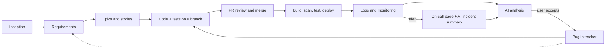
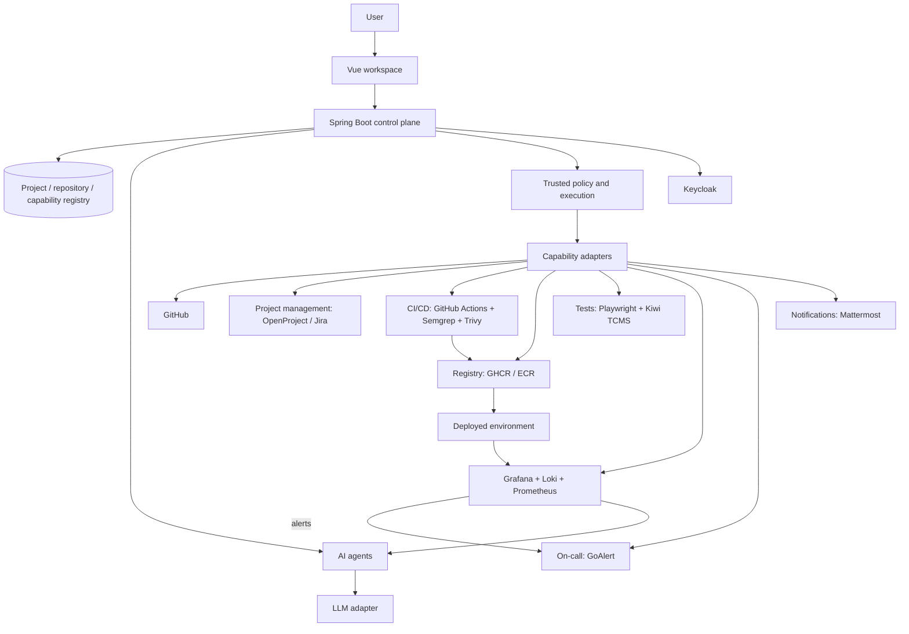

# Architecture

[← Documentation index](README.md)

## The closed loop



| Stage        | What happens                                                                                                                                    | Human control point                                                             | Authority                                                       |
| ------------ | ----------------------------------------------------------------------------------------------------------------------------------------------- | ------------------------------------------------------------------------------- | --------------------------------------------------------------- |
| Inception    | AI captures the project charter ([Requirements phase](requirements/01-requirements.md))                                                         | User confirms the charter                                                       | UnityStack, then Git once a repository is linked                |
| Requirements | AI drafts and revises requirement documents                                                                                                     | User finalises a revision → PR                                                  | Git                                                             |
| Planning     | AI proposes epics, stories and acceptance criteria                                                                                              | User finalises → PR; after merge, published to the tracker                      | Git for the approved definition; tracker for operational status |
| Development  | AI proposes code and tests together for a story                                                                                                 | User finalises → PR                                                             | Git                                                             |
| Review       | PR reviewed and merged under repository policy                                                                                                  | Reviewer / policy                                                               | GitHub                                                          |
| Delivery     | CI builds, scans (SAST, dependencies, images, secrets), tests, publishes the image and deploys; later a DAST scan runs against the deployed app | Environment protection, release policy, failing scans or tests block per policy | CI/CD system; test results in the test-management tool          |
| Observe      | Logs and metrics collected, tagged with service version and Change ID                                                                           | —                                                                               | Monitoring system                                               |
| Alert (P1)   | An alert pages the on-call developer; AI investigates and adds a summary to the incident                                                        | On-call developer acknowledges                                                  | On-call tool                                                    |
| Analyse      | User asks AI about behaviour in an environment; AI answers with log evidence                                                                    | —                                                                               | UnityStack (analysis is derived, not authoritative)             |
| Feedback     | AI proposes a bug with evidence                                                                                                                 | User accepts → bug created in tracker                                           | Tracker                                                         |

**Rules:** each stage can be done outside UnityStack and still be linked ([Traceability and integration](requirements/09-traceability-and-integration.md)). AI never advances a stage on its own: transitions come from user actions, policy and verified source events.

## Current implementation (27 November 2026)

| Part          | Implementation                                                                                                                                                                                                      |
| ------------- | ------------------------------------------------------------------------------------------------------------------------------------------------------------------------------------------------------------------- |
| Frontend      | Vue 3 + Vite, served by nginx (`frontend/`)                                                                                                                                                                         |
| Control plane | Java + Spring Boot (`backend/`), Flyway migrations                                                                                                                                                                  |
| AI            | Inside the Spring Boot backend, behind the provider-neutral `InceptionAgent` interface; mock and OpenAI implementations. Stays in Java ([AD-1](decisions.md#ad-1)); to be moved into its own framework-free module. |
| State         | PostgreSQL                                                                                                                                                                                                          |
| Runtime       | Local Docker Compose (PostgreSQL + backend + frontend)                                                                                                                                                              |
| Identity      | Not yet; Keycloak to be added ([AD-3](decisions.md#ad-3))                                                                                                                                                           |
| Cloud         | None yet; AWS after the thin loop works ([AD-2](decisions.md#ad-2))                                                                                                                                                 |

## Target logical architecture



- **Control plane:** portal, API, registry, identity and policy, workflow state.
- **AI plane:** agents and the LLM adapter, in a separate framework-free Java module ([AD-1](decisions.md#ad-1)); models hold no direct infrastructure permissions.
- **Integration plane:** capability adapters, optionally exposed via MCP behind trusted execution.
- **Data plane:** the Git provider (GitHub first) for canonical artifacts; PostgreSQL for application and workflow data; tool databases for tool data; the observability provider for logs and metrics.
- **Deployment plane:** CI/CD deploys the managed application; infrastructure as code provisions environments.

## Code organisation: feature modules

Decided in [AD-5](decisions.md#ad-5). The code is split by **feature module**, not by file type: there is no single `controller` or `service` package for the whole application. Each module contains everything for its area — API, services, domain, agents, prompts, adapters, persistence and UI — and the module list follows the SDLC phases used in the [requirements](requirements/README.md).

### Backend (Spring Boot)

```text
backend/src/main/java/io/unitystack/platform/
  core/                      shared, used by every module
    ai/                      LLM adapter interface, providers (mock, OpenAI), agent runtime — framework-free (AD-1)
    adapters/                capability registry and base adapter interfaces
    workspace/               drafts, revisions, diff, finalise → PR flow
    scm/                     Git provider adapters (GitHub first, AD-4)
    identity/                Keycloak integration, roles, resource permissions
    changeid/                Change ID generation and propagation
    common/                  errors, shared types
    persistence/             shared JPA support (JSONB mapping, assigned-ID base entity)
  requirements/              inception, projects, requirements and planning
    api/  application/  domain/  agents/  adapters/openproject/  persistence/
  design/                    architecture and design phase features (diagrams, ADRs, docs)
  development/               developer agent, code + tests proposals, PR handling
  testing/                   test agents, test runs and reports
    adapters/playwright/  adapters/kiwi/
  deployment/                builds, environments, images, feature flags
    adapters/githubactions/  adapters/ghcr/  adapters/unleash/
  monitoring/                log and metric queries, AI analysis, alerts, on-call, bugs
    adapters/loki/  adapters/prometheus/  adapters/grafana/  adapters/goalert/
  security/                  security scanning results and policies
    adapters/semgrep/  adapters/trivy/  adapters/zap/
  communication/             notifications, later the meeting assistant
    adapters/mattermost/
  traceability/              trace links, timelines, external sync and reconciliation
```

Inside a module the same layout repeats: `api/` (REST controllers, the module's public interfaces and events), `application/` (services, use cases), `domain/` (entities and rules), `agents/` (the module's AI agents and prompts), `adapters/<tool>/` (adapters for the tools this module owns) and `persistence/` (repositories).

### Frontend (Vue)

```text
frontend/src/
  core/                      app shell, router, auth, HTTP client, design system
    workspace/               the shared two-pane chat + preview components
  modules/
    requirements/            views, components, api, store for inception and planning
    design/
    development/
    testing/
    deployment/
    monitoring/
    security/
    communication/
    traceability/
```

Each frontend module registers its own routes and talks to its backend module's API only.

### Rules

1. **Public surface only.** A module may use another module's `api/` package (interfaces, DTOs, events) and nothing else. Internal packages are private.
2. **Events between phases.** Phase hand-offs use events (for example `RequirementApproved` → development, `DeploymentCompleted` → monitoring) rather than direct calls, so modules stay loosely coupled.
3. **No cycles.** Module dependencies form a one-way graph; `core` depends on no feature module.
4. **Adapters live with their owner.** Each tool adapter belongs to the module that owns that capability (for example Kiwi TCMS in `testing`, Loki in `monitoring`). Other modules use it through the owner's public interface.
5. **Own your data.** Each module owns its tables (for example a table-name prefix per module and its own migrations). No module reads another module's tables. Data access uses Spring Data JPA with flexible content in PostgreSQL JSONB ([TD-12](decisions.md#td-12)).
6. **AI stays portable.** Agents and prompts live in their feature module but use only `core/ai` interfaces and plain data objects, so the AI parts can be moved to another language later without touching the rest ([AD-1](decisions.md#ad-1)).
7. **Checked automatically.** A Spring Modulith test (`ApplicationModules.of(...).verify()`) fails the build if a module reaches into another module's internals or creates a cycle. Spring Modulith can also generate module diagrams for this document. On the frontend, a lint rule (for example `eslint-plugin-boundaries`) blocks imports from another module's internals.

### Where the original code went

The Phase 0 restructure moved the first inception code into this layout without changing behaviour:

| Before                                                            | Now                                                                                                                                                                                             |
| ----------------------------------------------------------------- | ----------------------------------------------------------------------------------------------------------------------------------------------------------------------------------------------- |
| `inception/`, `project/`                                          | `requirements/api` (controllers, request and response records), `application` (services), `domain` (`Charter`, `CharterMarkdown`, `ProjectKeys`), `persistence` (JPA entities and repositories) |
| `ai/` (inception agent, mock and OpenAI implementations, prompts) | Provider-neutral `LlmClient` and the OpenAI provider → `core/ai/`; inception agents (LLM-backed and scripted mock) and prompts → `requirements/agents/`                                         |
| `common/`                                                         | `core/common/`                                                                                                                                                                                  |
| JDBC repository                                                   | Spring Data JPA in `requirements/persistence/`, with shared JPA support in `core/persistence/` (TD-12)                                                                                          |
| `frontend/src/views/*`, `components/CharterPreview.vue`           | `frontend/src/modules/requirements/`                                                                                                                                                            |
| `frontend/src/api.js`                                             | HTTP client → `core/http.js`; inception calls → `modules/requirements/api.js`                                                                                                                   |

The existing tables (`project`, `charter_revision`, `open_question`, `inception_conversation`, `audit_event`) and REST paths (`/api/inception`, `/api/projects`) kept their names. Renaming them to the module prefix is a separate change.

## Delivery architecture

Every tool below sits behind a UnityStack adapter; changing one means changing its adapter and configuration only ([Core platform](requirements/10-core-platform.md)).

| Area                 | Initial implementation                                                                                                    | Evolution                                                                                                                           |
| -------------------- | ------------------------------------------------------------------------------------------------------------------------- | ----------------------------------------------------------------------------------------------------------------------------------- |
| Frontend             | Vue 3 + Vite, responsive two-pane workspace                                                                               | Module-specific previews, richer collaboration                                                                                      |
| Control plane        | Java 21 + Spring Boot                                                                                                     | Policies, assignments, tool adapters, orchestration                                                                                 |
| AI                   | Java, in its own framework-free module behind interfaces with plain data objects ([AD-1](decisions.md#ad-1))              | More agents; can be lifted into a Python service later if needed                                                                    |
| Model access         | Provider-neutral LLM adapter (mock, OpenAI)                                                                               | Routing gateway, budgets and fallback                                                                                               |
| Identity             | Keycloak (OIDC) from the start ([AD-3](decisions.md#ad-3))                                                                | Federation with organisation identity providers                                                                                     |
| Operational state    | PostgreSQL                                                                                                                | Scalable workflow/event processing and search                                                                                       |
| Artifact storage     | GitHub repositories, behind the Git provider adapter                                                                      | Gitea, GitLab, Bitbucket, Azure DevOps adapters; multi-repo registry and cross-repo change sets                                     |
| Preview              | Markdown renderer + textual diff                                                                                          | Mermaid, stories, code, tests, deployment previews                                                                                  |
| Streaming            | SSE for chat/proposed revisions                                                                                           | More granular streaming, collaboration                                                                                              |
| CI/CD                | GitHub Actions                                                                                                            | Jenkins, Argo CD adapters                                                                                                           |
| Security scanning    | Semgrep (SAST) and Trivy (dependencies, images, IaC, secrets) in CI                                                       | OWASP ZAP (DAST) after deploy                                                                                                       |
| Tests                | JUnit, Vitest, Playwright; results in Kiwi TCMS                                                                           | Release test reports, coverage by requirement                                                                                       |
| Container registry   | Local image builds                                                                                                        | GitHub Container Registry and Amazon ECR with the AWS move; Harbor later                                                            |
| Project management   | OpenProject                                                                                                               | Jira adapter                                                                                                                        |
| Observability        | OpenTelemetry (Java agent + Collector) → Loki (logs), Prometheus (metrics), Grafana                                       | Elasticsearch/OpenSearch log adapters, AI evaluation, release correlation                                                           |
| Alerting and on-call | —                                                                                                                         | Grafana alerting (rules in Git) → GoAlert, plus AI incident summaries                                                               |
| Notifications        | —                                                                                                                         | Mattermost; Slack and Teams adapters                                                                                                |
| Feature flags        | —                                                                                                                         | OpenFeature with Unleash                                                                                                            |
| Runtime              | Local Docker Compose with profiles; AI rebuilds with `docker compose up --build`, `docker compose watch` for manual edits | AWS: Terraform + EC2 + Docker Compose as soon as the thin loop works, with per-PR preview and main environments; EKS when justified |

**Logical services:** Vue UI → Spring Boot trusted control plane (with the AI module inside it) → adapters to GitHub, OpenProject, CI, registry, test management and observability; PostgreSQL for state; Keycloak for identity. AI returns structured proposed changes; trusted code validates and applies them to a draft, and only trusted code creates branches/PRs after user finalisation.

## Artifact types and repository flexibility

UnityStack must not assume one repository or fixed folders.

| Artifact type                      | Typical Git representation               |
| ---------------------------------- | ---------------------------------------- |
| Requirements, epics, stories, bugs | Markdown / YAML                          |
| Wireframes                         | `.excalidraw` JSON                       |
| UX artifacts                       | Design exports, tokens, prototype source |
| Architecture                       | Mermaid, ADR Markdown                    |
| API contracts                      | OpenAPI YAML/JSON                        |
| Application code and tests         | Source files                             |
| Infrastructure                     | Terraform / deployment manifests         |
| CI/CD                              | GitHub Actions YAML                      |
| Observability configuration        | Dashboard, alert and SLO definitions     |
| Documentation                      | Markdown, `mkdocs.yml`                   |
| Catalogue metadata                 | `catalog-info.yaml`                      |

Illustrative repository registry (not a final schema):

```yaml
organization: abc-bank
project: digital-banking
repositories:
  - id: requirements
    provider: github
    repository: abc-bank/banking-requirements
    defaultBranch: main
    artifacts:
      - type: requirement
        path: requirements/
      - type: story
        path: stories/
  - id: customer-service
    provider: github
    repository: abc-bank/banking-customer-service
    defaultBranch: main
    artifacts:
      - type: source-code
        path: src/
      - type: unit-test
        path: src/test/
```

## Git and repository organisation

Current and planned repositories:

```text
UnityStack/                    # this repository (monorepo for now)
  frontend/
  backend/                     # control plane; AI in its own module (AD-1)
  docs/
    plans/
    architecture/              # later
    adr/                       # later
  Requirements.md
  docker-compose.yml           # with profiles
  .github/workflows/

unitystack-demo-app/           # Phase 0: the managed Hello World application
  src/
  tests/
  .github/workflows/

infrastructure (Phase 5)       # Terraform for AWS; folder or separate repository
```

UnityStack must eventually support monorepo, multi-repo and hybrid arrangements. For cross-repo changes, group linked PRs into a change set; do not assume atomic merging across repositories.
