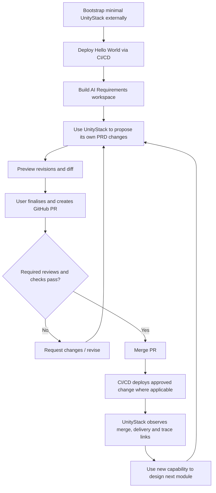

# UnityStack — Dogfooding Development Idea & Execution Plan

> **Enterprise AI Software Factory**  
> **From Requirements to Production. Powered by AI. Governed by Humans.**

**Document:** Development strategy and phased implementation plan  
**Version:** 1.0 (draft)  
**Date:** 21 November 2026  
**Status:** Proposed; milestones and estimates require validation

---

## 1. Executive idea

**Build UnityStack using UnityStack.** Start by creating the smallest production-deployed UnityStack shell with conventional engineering tools. Add a usable AI Requirements workspace. Then use that workspace to propose changes to UnityStack's own requirements document through GitHub pull requests (PRs). Continue building Architecture, Planning, Development, Testing, Delivery, and SDLC Intelligence modules, using each new module to help design and deliver the next one.

This is **dogfooding**: UnityStack becomes its first real customer. The product grows through its own governed delivery loop, while ordinary GitHub/IDE/CI/CD development remains fully supported.

**First product-defining success:** UnityStack reads its own approved requirements Markdown from GitHub; a user discusses a change with AI; the right pane shows a revised document and diff; the user finalises; UnityStack creates a PR; a reviewer or permitted policy merges it; UnityStack recognises the merge and shows the new approved version.

## 2. Product principles

1. **AI-first, not AI-only.** Creation and modification in the UnityStack MVP happen through conversation. Users may independently develop and submit PRs directly in GitHub at any time.
2. **Two-pane workspace.** Left: AI chat. Right: live, read-only artifact preview, revision history, and changes. Review/finalise actions are allowed; direct inline artifact editing is not an MVP requirement.
3. **Human-governed changes.** AI proposes; users inspect and finalise; GitHub PR and organisation policy determine reviews, checks, merge and deployment permissions.
4. **GitHub owns Git state.** GitHub is authoritative for repositories, branches, commits, PRs, reviews and merged Git artifacts. UnityStack owns conversations, drafts, assignments, workflow and traceability state.
5. **Traditional SDLC remains independent.** Teams can create tickets, write code, review PRs and deploy entirely outside UnityStack. UnityStack observes and reconciles supported external activity.
6. **Walking skeleton and continuous delivery.** Deploy Hello World to a production-designated environment on day one; grow functionality through small reviewed changes.
7. **Everything durable and reviewable as code where appropriate.** Requirements, ADRs, Mermaid diagrams, OpenAPI, code, tests and infrastructure configurations are Git artifacts. Runtime state, credentials, and native tool databases are not Git artifacts.
8. **One reusable workspace, many modules.** Reuse chat, preview, diff, revision, finalisation and PR capabilities; vary agents and renderers by SDLC role.
9. **Pluggable tool architecture.** Start with GitHub and the selected default tools. Later support existing enterprise tools and alternative providers without replacing the UnityStack user experience.
10. **End-to-end provenance.** Associate business changes with requirements, design, stories, PRs, tests, deployments, incidents and operational telemetry; distinguish verified from AI-inferred links.

## 3. Dogfooding loop



**Practical limitation:** UnityStack cannot bootstrap itself from nothing. Initial source repositories, CI/CD, cloud infrastructure, application shell and first AI integration are created with Codex, IDEs and normal engineering practices.

## 4. Delivery architecture (initial target)

| Area | Initial implementation | Evolution |
|---|---|---|
| Frontend | Vue 3 + Vite, responsive two-pane workspace | Module-specific previews, richer collaboration |
| Control plane | Java 21 + Spring Boot | Policies, assignments, tool adapters, orchestration |
| AI | Python service; simple LangGraph requirements flow | Architect/developer/QA agents, bounded multi-agent workflows |
| Model access | Provider-neutral model adapter/config | LiteLLM or equivalent routing, budgets and fallback |
| Operational state | PostgreSQL | Scalable workflow/event processing and search |
| Artifact storage | GitHub repositories | Multi-repo registry and cross-repo change sets |
| Preview | Markdown renderer + textual diff | Mermaid, stories, code, tests, deployment previews |
| Streaming | SSE for chat/proposed revisions | More granular streaming, collaboration |
| CI/CD | GitHub Actions | External CI/CD integrations |
| AWS | Terraform + EC2 + Docker Compose for low-complexity MVP | Managed services / EKS as enterprise requirements justify |
| Observability | Health checks, structured logs, basic metrics | Distributed tracing, AI evaluation and release correlation |

**Logical services:** Vue UI → Spring Boot trusted control plane → Python AI service; control plane integrates with GitHub and PostgreSQL. AI returns structured proposed changes; trusted code validates and applies them to a draft, and only trusted code creates branches/PRs after user finalisation.

## 5. Workspace and artifact contract

**Common workspace:**

- Left pane: conversation, questions, clarifications, AI progress and references.
- Right pane: approved baseline, proposed revision, preview/diff/history tabs, validation feedback, finalise/create PR.
- Context: organisation, project, role/module, current work item, Git repo/path/ref, source artifact version and related change ID.
- Draft lifecycle: `OPEN → PROPOSED → USER_ACCEPTED → PR_OPEN → MERGED` (or `REVISE / REJECT / CLOSED`). PR and merge states are read from GitHub, not guessed from chat.
- Every proposed revision records source baseline, author/agent run, timestamp, diff and validation results. Drafts live in UnityStack storage; approved Git artifacts live in GitHub.
- MVP preview is **read-only**. Future: button to open artifacts in a supported web or local editor; no need to build that in the MVP.

| Module | Right-hand preview | First relevant capability |
|---|---|---|
| Requirements | BRD/PRD Markdown, inline changes | AI edits an existing Git Markdown document |
| Architecture | HLD/LLD, ADR, rendered Mermaid and source diff | Generate/revise UnityStack architecture |
| Planning | Epic/story/bug hierarchy, acceptance criteria and changes | Decompose approved requirements into proposed work |
| Development | Changed files, code diff, build/test feedback | AI proposes code PRs with bounded execution |
| Testing | Test scenarios, test code, result summary | Generate tests and review coverage |
| Delivery | Build/release/deployment state and links | Track release to environment and feature |
| Intelligence | Cross-tool timeline and traceability graph | Explain past work even when done outside UnityStack |

## 6. Phased implementation plan

### Phase 0 — Bootstrap and deploy the walking skeleton (v0.0.1)

**Goal:** A real application, reachable in a production-designated AWS environment, with automated delivery from GitHub.

**Build:**
- Create `unitystack-platform` repository (Vue, Spring Boot, optional placeholder Python service) and `unitystack-infrastructure` repository (Terraform, deployment configuration).
- Establish application shell, health endpoint, environment configuration and structured logging.
- Terraform-provision minimal AWS resources; use pinned container images and Docker Compose for the initial platform.
- GitHub Actions: build, unit tests, container build, deployment, smoke/health checks; require appropriate environment protection and least-privilege AWS OIDC access.
- Secrets outside Git; HTTPS, backups and basic monitoring. Use development/staging environments as practical, while retaining a production-designated continuously delivered baseline.

**Dogfooding demonstration:** A conventional developer-created PR changes Hello World text, is reviewed, merged and deployed successfully.

**Exit criteria:** Clean repeatable deploy; health checks pass; rollback/redeploy procedure documented; no secrets committed.

### Phase 1 — AI Requirements workspace (v0.1)

**Goal:** Use UnityStack to update its own requirements document.

**Build:**
- Project/repository/artifact configuration for the UnityStack PRD path.
- Project Inception (PRD §10): AI-led New Project conversation with live charter preview; dogfood by creating the UnityStack project itself.
- Two-pane UI with chat, Markdown preview, baseline/proposed diff, revision history and finalise action.
- AI requirements flow: retrieve approved Markdown from GitHub; discuss change; produce a **structured patch or revised document**; validate document shape and identifiers; save draft revision.
- Trusted GitHub integration: create branch, commit proposed Markdown, open PR; show PR URL/status.
- Webhook ingestion plus basic periodic reconciliation for PR merge/rejection status.
- Minimal identity, authorised repo access, audit records and policy checks. Review policy may require an independent approver; auto-merge only if explicitly permitted and required checks pass.

**Dogfooding demonstration:** Ask UnityStack to add a requirement to its own PRD; preview the exact diff; finalise; review and merge PR; refresh approved PRD from GitHub.

**Exit criteria:** No direct manual editing inside UnityStack; no PR before finalisation; no overwrite of concurrent upstream changes; every PR links to draft revision and actor.

### Phase 2 — Architecture workspace (v0.2)

**Goal:** Use UnityStack to design UnityStack.

**Build:**
- Reuse chat, draft, diff, finalise and PR mechanisms.
- Architecture agent for HLD/LLD, component descriptions and ADR proposals.
- Markdown + Mermaid renderer; diagram source diff (advanced visual diff deferred).
- Artifact references to approved requirements; explicit assumptions and architecture decision status.

**Dogfooding demonstration:** Ask AI to design the Requirements module and GitHub integration; preview Mermaid diagrams and ADRs; approve PRs to `docs/architecture/`.

**Exit criteria:** Architecture artifact links to source requirement IDs; approved diagram and ADR are Git-versioned; renderer safely handles untrusted content.

### Phase 3 — Planning and story decomposition (v0.3)

**Goal:** Turn approved requirements into reviewable work, without manual story entry in UnityStack.

**Build:**
- AI proposes number of epics, stories, bugs/tasks and acceptance criteria according to scope.
- Hierarchical preview with change indicators and conversational revision.
- Finalisation → Git PR for canonical YAML/Markdown work definitions → policy review/merge.
- Initial OpenProject adapter publishes approved items after merge, with stable external IDs and idempotent retry.
- Basic My Work queue and work state transitions; keep tool-native operational records authoritative.

**Dogfooding demonstration:** Decompose the Development Module requirement into epics/stories and publish approved work to OpenProject.

**Exit criteria:** Rejected proposals create no OpenProject records; retries do not duplicate items; approved stories retain Git and OpenProject links.

### Phase 4 — Development assistant (v0.4)

**Goal:** Use UnityStack to propose selected UnityStack code changes.

**Build:**
- Read linked requirements, ADRs, story, repository context and coding conventions.
- Bounded, isolated agent workspace; file allowlist; test/lint execution; code diff preview.
- Branch/commit/PR via trusted service after user finalisation; never allow LLM direct merge or production credentials.
- Track independently created GitHub PRs alongside AI-created PRs.

**Dogfooding demonstration:** AI proposes a small UnityStack feature or bug fix; developer reviews and merges a PR; normal CI/CD deploys it.

**Exit criteria:** Reproducible tests; safe execution boundaries; no AI bypass of GitHub branch protections; conventional IDE/PR workflow still works.

### Phase 5 — Testing and quality (v0.5)

**Goal:** Generate and govern test artifacts with AI.

**Build:**
- QA agent proposes unit/integration/API tests and acceptance scenarios based on linked requirements.
- Test preview, coverage summary, code diff and Git PR flow.
- Integrate test and quality results from CI; later connect SonarQube.

**Dogfooding demonstration:** Generate tests for UnityStack's requirements PR workflow, review, merge and execute them in CI.

**Exit criteria:** Tests are linked to requirements/stories; failed checks block merge according to repository policy.

### Phase 6 — Workflow orchestration and traceability (v0.6)

**Goal:** Progress work across SDLC phases and explain how a change reached production.

**Build:**
- Deterministic workflow engine in Spring Boot/PostgreSQL; assign/reassign/approve/reject tasks and manage dependencies.
- Parallel work where safe (e.g., architecture and story decomposition, implementation and test planning).
- Stable `Change ID` across requirement, ADR, story, PR, test, build, release and incident; distinguish from runtime OpenTelemetry trace IDs.
- Link deployments using commit SHA, build/run ID, artifact version and environment.
- Automatic workflow advancement from verified external events, not AI speculation.

**Dogfooding demonstration:** Trace one UnityStack feature from PRD requirement through production release and related tests.

**Exit criteria:** End-to-end timeline is reproducible from stored provenance; incomplete links are visible, not fabricated.

### Phase 7 — Passive SDLC intelligence (v0.7)

**Goal:** Observe work performed without using UnityStack.

**Build:**
- GitHub webhooks for PRs, commits, reviews and merges; OpenProject API/events where supported; CI/CD build/deployment ingestion.
- Scheduled reconciliation, deduplication, checkpoints, retry/dead-letter handling and replay.
- Import a bounded set of historical GitHub/OpenProject records; preserve source IDs, URLs, timestamps, permissions and evidence.
- Verified and AI-inferred relationships clearly differentiated.

**Dogfooding demonstration:** A developer creates a story and completes a PR entirely outside UnityStack; UnityStack discovers the work, links its evidence and updates the traceability view.

**Exit criteria:** External workflows are not blocked; missed events can be recovered within the available source retention window; ambiguous links require review.

### Phase 8 — Enterprise distribution and onboarding (v0.8+)

**Goal:** Turn the dogfooded platform into an installable product for other organisations.

**Build:**
- Versioned AWS installer and application manifests; installation profiles, preflight checks, health validation, upgrade/rollback, backup/restore.
- Full default distribution with selected open-source tools: OpenProject, Excalidraw, Penpot, Mermaid, MkDocs, Backstage, Swagger UI, Eclipse Theia and SonarQube (where applicable, Mermaid is a library rather than a standalone server).
- Organisation-specific configuration, identity foundation, permissions, domain/TLS, secrets and tool health.
- Greenfield install or connect-existing onboarding; initial historical ingestion plus ongoing synchronisation.
- Future BYOT: use default, connect existing or provision an alternative provider (e.g., Jira), subject to licensing and available deployment mechanisms.

**Dogfooding demonstration:** Deploy a separate test organisation, connect its GitHub/OpenProject history, ingest data and use UnityStack without disrupting its existing SDLC.

**Exit criteria:** Repeatable fresh install, upgrade and restore tested; onboarding report identifies imported records, gaps and integration health.

## 7. MVP scope boundaries

**First usable MVP (v0.1) includes:** working deployed shell; requirements AI conversation; GitHub PRD retrieval; Markdown preview and diff; draft revisions; explicit finalise → PR; status synchronisation; basic auth/policy/audit; conventional GitHub workflow compatibility.

**Not required for v0.1:** manual artifact editors inside UnityStack; full multi-agent autonomy; complete nine-tool integration; Penpot editing; code generation; multi-cloud; Jira BYOT; enterprise historical ingestion; sophisticated visual diagram diffs; production-grade HA.

**Full enterprise vision remains:** installable AI Software Factory, tool-provider choices, independent SDLC observation, historical ingestion, workflow intelligence and end-to-end delivery traceability.

## 8. Git and repository organisation

Suggested starting repositories:

```text
unitystack-platform/
  frontend/
  backend/
  ai-service/
  docs/
    requirements/UnityStack_Requirements.md
    architecture/
    adr/
  .github/workflows/

unitystack-infrastructure/
  terraform/aws/
  deployment/docker-compose/
  .github/workflows/
```

Use an additional `unitystack-demo-app` repository later to validate managing a customer application separately from UnityStack itself. UnityStack must eventually support monorepo, multi-repo and hybrid arrangements. For cross-repo changes, group linked PRs into a change set; do not assume atomic merging across repositories.

## 9. Work items and prioritisation

**Immediate implementation order:**

1. Create repository skeleton and Docker-based local run.
2. Add CI/CD and Terraform-backed AWS walking skeleton.
3. Implement GitHub read of the approved PRD.
4. Implement chat and structured AI proposal endpoint.
5. Implement preview, revision persistence and diff.
6. Implement finalisation, branch/commit/PR and error handling.
7. Implement webhook status updates and periodic PR reconciliation.
8. Dogfood one real requirements change end to end.
9. Use the Requirements module to propose the Architecture module.

**Suggested vertical-slice backlog:**

| ID | Story | Evidence of completion |
|---|---|---|
| BOOT-01 | Deploy Hello World | Production-designated URL + passing smoke test |
| PRJ-01 | Create a project via AI inception | Project + charter revision 1 stored after explicit confirmation |
| REQ-01 | Load PRD from GitHub | Correct repo/path/ref and SHA shown |
| REQ-02 | Discuss a requirement change | AI returns validated proposed revision |
| REQ-03 | Show preview and diff | Exact additions/deletions visible |
| REQ-04 | Keep draft revisions | Previous draft accessible; baseline unchanged |
| GOV-01 | Finalise and create PR | GitHub PR contains only intended changes |
| GOV-02 | Track review/merge | UI reflects GitHub source state |
| GOV-03 | Enforce policies | Unauthorised merges/actions rejected |
| SYNC-01 | Recover missed webhook | Scheduled reconciliation restores status |
| DOG-01 | Update UnityStack PRD with UnityStack | Merged PR becomes approved baseline |

## 10. Data, provenance and safety rules

- Store organisation/project/repo/artifact identity and exact baseline commit SHA for every draft.
- If upstream baseline changes, show conflict/rebase options; never silently overwrite.
- Treat repository content, tool responses and retrieved documents as untrusted inputs to agents; prevent prompt injection from becoming executable authority.
- Use least-privilege GitHub App permissions and short-lived credentials; secret storage in AWS Secrets Manager/SSM.
- Separate human actor, agent run and trusted execution service identities in audit records.
- Validate AI-generated patches against schemas, path constraints and repository policies before writing.
- Make sync jobs idempotent; use source-specific stable IDs, event deduplication and checkpoints.
- Source tools remain authoritative for their operational records; UnityStack maintains derived records and relationships.
- Retain source evidence for trace links; mark inferred links with confidence and verification status.
- Do not promise perfect historical reconstruction: deleted, inaccessible or never-recorded source data may be unrecoverable.
- Protect production with branch/environment rules, tests, security gates and optional release approvals.

## 11. Measuring success

| Milestone | Demonstrable outcome |
|---|---|
| v0.0.1 | A conventional PR deploys Hello World automatically after required gates |
| v0.1 | UnityStack updates its own PRD via AI preview and GitHub PR |
| v0.2 | UnityStack proposes and versions its own Mermaid HLD and ADR |
| v0.3 | UnityStack generates its own approved epics/stories and publishes them to OpenProject |
| v0.4 | UnityStack proposes a code change, tested and reviewed in GitHub |
| v0.5 | UnityStack generates and runs traceable tests |
| v0.6 | A feature can be traced from requirement to deployed release |
| v0.7 | External-only story/PR activity appears without UnityStack participation |
| v0.8+ | A new organisation can install/connect, ingest and begin using the platform |

Track practical engineering measures: PR success rate, AI revision acceptance rate, escaped defects, time from proposal to merge, deployment frequency, change failure rate, recovery time, sync lag, ingestion coverage and cost per AI task. Establish baselines before setting numerical targets.

## 12. Risks and mitigation

| Risk | Mitigation |
|---|---|
| Attempting all nine tools immediately | Deliver a narrow dogfooding vertical slice first; package full stack later |
| AI corrupts approved docs | Baseline SHA, schema checks, read-only preview, user finalisation and Git PR |
| Agents receive excessive permissions | Trusted execution layer, least privilege, sandbox, human governance |
| GitHub and UnityStack drift | Webhooks plus periodic reconciliation; GitHub remains authoritative |
| External SDLC records lack links | Preserve provenance; infer cautiously; show unresolved relationships |
| AWS cost rises | Small initial footprint, resource budgets, stop nonessential services |
| CI/CD deploys faulty changes | Tests, protected branches, health checks, rollback and feature flags |
| Circular dependency on unfinished modules | Bootstrap each module conventionally, then use it to design the next |
| Tool licensing or SSO limitations | Validate deployment rights and edition-specific capabilities before packaging |

## 13. Decision register

**Confirmed product decisions:**
- Name and positioning: **UnityStack — Enterprise AI Software Factory**.
- AI-first two-pane workspace; preview read-only in MVP.
- Direct human edits via external editors are a future capability.
- Conventional external SDLC must continue unrestricted.
- GitHub is authoritative for Git/PR state; UnityStack for orchestration state.
- Webhooks and reconciliation observe external work.
- Single-organisation install initially; AWS-only MVP.
- Continuous delivery starts with a walking skeleton.
- Enterprise onboarding and historical ingestion are strategic product capabilities.

**Implementation proposals to validate:**
- Spring Boot + Python LangGraph separation, PostgreSQL and SSE.
- Terraform + EC2/Docker Compose as the first AWS deployment mechanism.
- Specific release numbering, scope and sequencing.
- Exact identity provider, event broker, model router and operational SLOs.

## 14. First sprint: definition of done

The first sprint is complete when a developer can clone the repos, run the application locally, submit a PR, pass automated tests, merge with required review, and observe a healthy Hello World deployment in the AWS production-designated environment. Document the installation, deployment and recovery commands. Then begin Phase 1 with the approved UnityStack requirements document in GitHub.

---

**Guiding statement:** *We will build the smallest UnityStack that can improve UnityStack, then use each approved capability to help build the next one—without disrupting conventional software engineering.*
