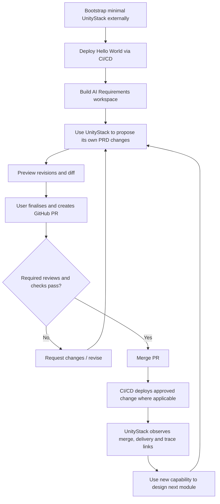

# UnityStack — Dogfooding Development Idea & Execution Plan

> **Enterprise AI Software Factory**  
> **From Requirements to Production. Powered by AI. Governed by Humans.**

**Document:** Development strategy and phased implementation plan  
**Version:** 1.1 (draft, aligned with PRD v2.1)  
**Date:** 27 November 2026  
**Status:** Proposed; milestones and estimates require validation

---

## 1. Executive idea

**Build UnityStack using UnityStack.** Start by creating the smallest UnityStack shell with conventional engineering tools, running locally in Docker. Add a usable AI Requirements workspace. Then use that workspace to propose changes to UnityStack's own requirements document through GitHub pull requests (PRs). Build the whole loop thin from end to end first (requirements → stories → code and tests → PR → deploy → logs → AI analysis → bug), using each new stage to help build the next one. Then move to AWS and deepen each stage (PRD PD-4, AD-2).

This is **dogfooding**: UnityStack becomes its first real customer. The product grows through its own governed delivery loop, while ordinary GitHub/IDE/CI/CD development remains fully supported.

**First product-defining success:** UnityStack reads its own approved requirements Markdown from GitHub; a user discusses a change with AI; the right pane shows a revised document and diff; the user finalises; UnityStack creates a PR; a reviewer or permitted policy merges it; UnityStack recognises the merge and shows the new approved version.

## 2. Product principles

1. **AI-first, not AI-only.** Creation and modification in the UnityStack MVP happen through conversation. Users may independently develop and submit PRs directly in GitHub at any time.
2. **Two-pane workspace.** Left: AI chat. Right: live, read-only artifact preview, revision history, and changes. Review/finalise actions are allowed; direct inline artifact editing is not an MVP requirement.
3. **Human-governed changes.** AI proposes; users inspect and finalise; GitHub PR and organisation policy determine reviews, checks, merge and deployment permissions.
4. **The Git provider owns Git state.** The connected Git provider (GitHub first, behind an adapter) is authoritative for repositories, branches, commits, PRs, reviews and merged Git artifacts. UnityStack owns conversations, drafts, assignments, workflow and traceability state.
5. **Traditional SDLC remains independent.** Teams can create tickets, write code, review PRs and deploy entirely outside UnityStack. UnityStack observes and reconciles supported external activity.
6. **Walking skeleton and continuous delivery.** Deploy Hello World through an automated pipeline on day one (locally first, then AWS); grow functionality through small reviewed changes.
7. **Everything durable and reviewable as code where appropriate.** Requirements, ADRs, Mermaid diagrams, OpenAPI, code, tests and infrastructure configurations are Git artifacts. Runtime state, credentials, and native tool databases are not Git artifacts.
8. **One reusable workspace, many modules.** Reuse chat, preview, diff, revision, finalisation and PR capabilities; vary agents and renderers by SDLC role.
9. **Pluggable tool architecture.** Start with GitHub and the selected default tools. Later support existing enterprise tools and alternative providers without replacing the UnityStack user experience.
10. **End-to-end provenance.** Associate business changes with requirements, design, stories, PRs, tests, deployments, incidents and operational telemetry; distinguish verified from AI-inferred links.

## 3. Dogfooding loop



**Practical limitation:** UnityStack cannot bootstrap itself from nothing. Initial source repositories, CI/CD, cloud infrastructure, application shell and first AI integration are created with Codex, IDEs and normal engineering practices.

## 4. Delivery architecture (initial target)

Every tool below sits behind a UnityStack adapter; changing one means changing its adapter and configuration only (PRD §8).

| Area | Initial implementation | Evolution |
|---|---|---|
| Frontend | Vue 3 + Vite, responsive two-pane workspace | Module-specific previews, richer collaboration |
| Control plane | Java 21 + Spring Boot | Policies, assignments, tool adapters, orchestration |
| AI | Java, in its own framework-free module behind interfaces with plain data objects (AD-1) | More agents; can be lifted into a Python service later if needed |
| Model access | Provider-neutral LLM adapter (mock, OpenAI) | Routing gateway, budgets and fallback |
| Identity | Keycloak (OIDC) from the start (AD-3) | Federation with organisation identity providers |
| Operational state | PostgreSQL | Scalable workflow/event processing and search |
| Artifact storage | GitHub repositories, behind the Git provider adapter | Gitea, GitLab, Bitbucket, Azure DevOps adapters; multi-repo registry and cross-repo change sets |
| Preview | Markdown renderer + textual diff | Mermaid, stories, code, tests, deployment previews |
| Streaming | SSE for chat/proposed revisions | More granular streaming, collaboration |
| CI/CD | GitHub Actions | Jenkins, Argo CD adapters |
| Security scanning | Semgrep (SAST) and Trivy (dependencies, images, IaC, secrets) in CI | OWASP ZAP (DAST) after deploy |
| Tests | JUnit, Vitest, Playwright; results in Kiwi TCMS | Release test reports, coverage by requirement |
| Container registry | GitHub Container Registry | Amazon ECR with the AWS move; Harbor later |
| Project management | OpenProject | Jira adapter |
| Observability | Grafana, Loki (logs), Prometheus (metrics) | Distributed tracing, AI evaluation, release correlation |
| Alerting and on-call | — | Grafana alerts → GoAlert, plus AI incident summaries |
| Notifications | — | Mattermost; Slack and Teams adapters |
| Feature flags | — | OpenFeature with Unleash |
| Runtime | Local Docker Compose with profiles | AWS: Terraform + EC2 + Docker Compose as soon as the thin loop works; EKS when justified |

**Logical services:** Vue UI → Spring Boot trusted control plane (with the AI module inside it) → adapters to GitHub, OpenProject, CI, registry, test management and observability; PostgreSQL for state; Keycloak for identity. AI returns structured proposed changes; trusted code validates and applies them to a draft, and only trusted code creates branches/PRs after user finalisation.

## 5. Workspace and artifact contract

**Common workspace:**

- Left pane: conversation, questions, clarifications, AI progress and references.
- Right pane: approved baseline, proposed revision, preview/diff/history tabs, validation feedback, finalise/create PR.
- Context: organisation, project, role/module, current work item, Git repo/path/ref, source artifact version and related change ID.
- Draft lifecycle: `OPEN → PROPOSED → USER_ACCEPTED → PR_OPEN → MERGED` (or `REVISE / REJECT / CLOSED`). PR and merge states are read from GitHub, not guessed from chat.
- Every proposed revision records source baseline, author/agent run, timestamp, diff and validation results. Drafts live in UnityStack storage; approved Git artifacts live in GitHub.
- MVP preview is **read-only**. Future: button to open artifacts in a supported web or local editor; no need to build that in the MVP.

| Module | Right-hand preview | First relevant capability |
|---|---|---|
| Requirements | BRD/PRD Markdown, inline changes | AI edits an existing Git Markdown document |
| Architecture | HLD/LLD, ADR, rendered Mermaid and source diff | Generate/revise UnityStack architecture |
| Planning | Epic/story/bug hierarchy, acceptance criteria and changes | Decompose approved requirements into proposed work |
| Development | Changed files, code diff, build/test feedback | AI proposes code PRs with bounded execution |
| Testing | Test scenarios, test code, result summary | Generate tests and review coverage |
| Delivery | Build/release/deployment state and links | Track release to environment and feature |
| Intelligence | Cross-tool timeline and traceability graph | Explain past work even when done outside UnityStack |

## 6. Phased implementation plan

The phases follow the thin loop (PRD PD-4): Phases 0–4 build every stage of the loop in a basic form; Phase 4 completes the MVP (PRD §17). Each phase uses what the earlier phases built.

### Phase 0 — Local foundation and walking skeleton (v0.0.x)

**Goal:** A repeatable local stack, signed-in access and an automated pipeline for a Hello World application.

**Already built:** Project Inception (PRD §10) with Vue, Spring Boot, PostgreSQL and the mock/OpenAI LLM adapter in Docker Compose.

**Build:**
- Docker Compose profiles (`core`, `pm`, `test`, `monitoring`, …) so only the needed tools start.
- Keycloak in the `core` profile; UnityStack sign-in and basic roles; realm configuration exported to Git (no secrets).
- Move the AI code into its own framework-free module behind interfaces (AD-1).
- Capability registry skeleton and the first adapter interfaces (SCM, CI, registry, project management, test management, observability).
- Change ID scheme (PRD D-4) and generation at the start of a change.
- GitHub Actions for UnityStack itself: build, JUnit and Vitest, Semgrep, Trivy, image to GitHub Container Registry.
- `unitystack-demo-app` repository with a Hello World service and the same pipeline; deployed to the local environment (PRD D-16).
- Secrets only in `.env` locally; placeholders in `.env.example`.

**Dogfooding demonstration:** A conventional PR to the demo app changes the Hello World text; CI tests and scans it, publishes the image, and the local environment runs the new version.

**Exit criteria:** Clean repeatable local start; sign-in works; scans and tests run on every PR; no secrets committed.

### Phase 1 — Requirements to PR (v0.1)

**Goal:** Use UnityStack to update its own requirements document.

**Build:**
- Project/repository/artifact configuration for the UnityStack PRD path; charter proposed to Git via PR when a repository is linked (FR-108).
- Two-pane UI with chat, Markdown preview, baseline/proposed diff, revision history and finalise action.
- AI requirements flow: retrieve approved Markdown from GitHub; discuss change; produce a structured patch or revised document; validate document shape and identifiers; save draft revision with its Change ID.
- Trusted GitHub integration: create branch, commit proposed Markdown, open PR; show PR URL/status.
- Webhook ingestion plus basic periodic reconciliation for PR merge/rejection status.
- Audit records and policy checks; resource permissions through Keycloak roles and UnityStack rules.

**Dogfooding demonstration:** Ask UnityStack to add a requirement to its own PRD; preview the exact diff; finalise; review and merge the PR; refresh the approved PRD from GitHub.

**Exit criteria:** No direct manual editing inside UnityStack; no PR before finalisation; no overwrite of concurrent upstream changes; every PR links to draft revision, actor and Change ID.

### Phase 2 — Stories to the tracker (v0.2)

**Goal:** Turn approved requirements into reviewable work without manual story entry in UnityStack.

**Build:**
- AI proposes epics, stories and acceptance criteria according to scope; hierarchical preview with change indicators.
- Finalisation → Git PR for canonical YAML/Markdown work definitions → review/merge.
- OpenProject adapter (Compose profile `pm`) publishes approved items after merge, with stable external IDs, idempotent retry and the Change ID.

**Dogfooding demonstration:** Decompose a real UnityStack requirement into stories and publish them to OpenProject.

**Exit criteria:** Rejected proposals create no OpenProject records; retries do not duplicate items; stories keep Git, OpenProject and Change ID links.

### Phase 3 — Code and tests to deployment (v0.3)

**Goal:** AI proposes code and tests together for a story; CI scans, tests and deploys them.

**Build:**
- Developer agent reads the linked requirement, story, ADRs, repository context and conventions; proposes code **and** tests in a bounded, isolated workspace; file allowlist; lint and test execution; code diff preview.
- Branch/commit/PR via trusted service after finalisation; PR carries the Change ID; never direct merge or production credentials.
- CI: unit tests, Semgrep, Trivy, image to GitHub Container Registry tagged with version, commit SHA and Change ID; deploy to the local environment.
- Playwright end-to-end tests against the deployed version; test cases in Git; run results recorded in Kiwi TCMS (Compose profile `test`) against the release, with a per-release test report.

**Dogfooding demonstration:** AI implements a small demo-app story with tests; the PR is reviewed and merged; CI deploys it; the Kiwi report shows which tests ran and passed for that release.

**Exit criteria:** Code and tests arrive in one PR; failing tests or scans block per policy; test runs link to requirement, story and Change ID; conventional IDE/PR workflow still works.

### Phase 4 — Observe and feedback: thin loop complete (v0.4, MVP)

**Goal:** See how the deployed change behaves, let AI analyse it, and feed problems back as bugs.

**Build:**
- Demo app emits structured logs and metrics tagged with service version and Change ID (instrumentation standard: PRD D-15).
- Loki, Prometheus and Grafana in Compose profile `monitoring`; observability adapter for querying logs and metrics.
- AI analysis: the user asks whether things work as expected for an environment and time window; answers cite log entries.
- AI proposes a bug from evidence; after the user accepts it, the bug is created in OpenProject with links to Change ID, deployment and logs.
- Change ID timeline view from requirement to stories, PR, tests, deployment, logs and bug; gaps shown, not filled.

**Dogfooding demonstration:** Introduce a small fault in the demo app; AI finds it in the logs, proposes a bug, the bug goes to OpenProject, and the fix goes through the loop again.

**Exit criteria:** PRD §17 MVP acceptance passes.

### Phase 5 — Move to AWS (v0.5)

**Goal:** Run the working loop in AWS as soon as possible after the MVP (AD-2).

**Build:**
- Terraform for EC2, networking, storage and secrets (Secrets Manager or SSM); S3 remote state with locking.
- The same Docker Compose files on EC2; HTTPS; Keycloak behind TLS.
- Amazon ECR adapter alongside GitHub Container Registry; GitHub Actions deploys using OIDC with least-privilege roles.
- Optional middle step: move heavy tools (monitoring, test management, chat) to one EC2 host first while the app runs locally.
- Cost controls: stop the instance when not in use; spending alerts.

**Exit criteria:** Clean repeatable deploy to AWS; health checks pass; backups and a restore tested; no secrets committed.

### Phase 6 — Deepen the loop (v0.6)

**Build (each behind its adapter):**
- OWASP ZAP black-box scan after each deployment; findings linked to the deployment and Change ID.
- Grafana alert rules → GoAlert on-call paging with rotations, overrides and escalation; the same alert reaches UnityStack, where AI investigates and adds a summary to the incident.
- Mattermost notifications for review requests, alerts, incident summaries and failures.
- Feature flags through OpenFeature with Unleash.
- Jira adapter to prove project-management swappability.
- Architecture workspace: HLD/LLD, ADRs, Markdown + Mermaid renderer with source diff.
- Deterministic workflow engine, My Work queues, parallel work and dependencies.

**Dogfooding demonstration:** A production-like alert pages the developer, and AI's summary is already on the incident when they open it.

### Phase 7 — Passive intelligence and demo users (v0.7)

**Build:**
- GitHub webhooks for PRs, commits, reviews and merges; OpenProject events where supported; CI/CD ingestion; reconciliation, deduplication, checkpoints and replay.
- Bounded import of historical GitHub/OpenProject records with source IDs, URLs, timestamps and evidence; verified vs AI-inferred links.
- Multi-user roles and resource permissions; onboard a few developers for free demos.

**Dogfooding demonstration:** A developer creates a story and completes a PR entirely outside UnityStack; UnityStack discovers the work and links its evidence.

### Phase 8 — Enterprise distribution and onboarding (v0.8+)

**Build:**
- Versioned AWS installer and manifests; installation profiles, preflight checks, health validation, upgrade/rollback, backup/restore.
- Install-time choice of provider per capability (for example GitHub, Gitea, GitLab or Bitbucket; GitHub Container Registry, ECR or Harbor; GitHub Actions, Jenkins or Argo CD; Mattermost, Slack or Teams), with the default open-source set as the full profile.
- Organisation configuration, identity federation, domain/TLS, secrets and tool health.
- Greenfield install or connect-existing onboarding; historical ingestion plus ongoing synchronisation.
- Future: AI meeting assistant that joins requirement meetings, summarises them and proposes requirement updates (PRD FR-126).

**Exit criteria:** Repeatable fresh install, upgrade and restore tested; onboarding report identifies imported records, gaps and integration health.

## 7. MVP scope boundaries

**MVP (v0.4, thin loop) includes:** Inception; requirements AI conversation with GitHub PRD retrieval, preview, diff, revisions and finalise → PR; stories published to OpenProject; AI code and tests in one PR; CI with unit tests, Semgrep and Trivy; image in GitHub Container Registry; local deployment; Playwright tests with results in Kiwi TCMS; logs and metrics in Grafana, Loki and Prometheus; AI log analysis; accepted bugs back in OpenProject; Change ID timeline; Keycloak sign-in; status synchronisation; audit; conventional GitHub workflow compatibility.

**Not required for the MVP:** AWS (comes next, in Phase 5); OWASP ZAP; alerting and on-call; Mattermost; feature flags; Jira; architecture workspace; manual artifact editors; full multi-agent autonomy; Penpot editing; multi-cloud; enterprise historical ingestion; sophisticated visual diagram diffs; production-grade HA.

**Full enterprise vision remains:** installable AI Software Factory, tool-provider choices per capability, independent SDLC observation, historical ingestion, workflow intelligence and end-to-end delivery traceability.

## 8. Git and repository organisation

Current and planned repositories:

```text
UnityStack/                    # this repository (monorepo for now)
  frontend/
  backend/                     # control plane; AI in its own module (AD-1)
  docs/
    plans/
    architecture/              # later
    adr/                       # later
  Requirements.md
  docker-compose.yml           # with profiles
  .github/workflows/

unitystack-demo-app/           # Phase 0: the managed Hello World application
  src/
  tests/
  .github/workflows/

infrastructure (Phase 5)       # Terraform for AWS; folder or separate repository
```

UnityStack must eventually support monorepo, multi-repo and hybrid arrangements. For cross-repo changes, group linked PRs into a change set; do not assume atomic merging across repositories.

## 9. Work items and prioritisation

**Immediate implementation order:**

1. Docker Compose profiles and Keycloak sign-in.
2. Move the AI code into its own framework-free module.
3. Change ID scheme and generation.
4. GitHub Actions with unit tests, Semgrep, Trivy and GitHub Container Registry.
5. `unitystack-demo-app` Hello World with local deployment.
6. GitHub read of the approved PRD; chat and structured AI proposal endpoint.
7. Preview, revision persistence and diff; finalisation, branch/commit/PR and error handling.
8. Webhook status updates and periodic PR reconciliation; dogfood one real requirements change end to end.
9. Stories → OpenProject; code and tests → PR → deploy; Playwright and Kiwi; logs, AI analysis and bugs.

**Suggested vertical-slice backlog:**

| ID | Story | Evidence of completion |
|---|---|---|
| PRJ-01 | Create a project via AI inception | Done: project + charter revision 1 stored after explicit confirmation |
| BOOT-01 | Deploy Hello World | Local URL serves the demo app; smoke test passes |
| BOOT-02 | Sign in through Keycloak | Only signed-in users reach UnityStack; roles visible |
| BOOT-03 | Scan and test every PR | Unit tests, Semgrep and Trivy run in CI; failures block per policy |
| BOOT-04 | Publish images | Image in GitHub Container Registry tagged with version, SHA and Change ID |
| CHG-01 | Create a Change ID | Every new change gets an ID carried into branch, PR and build |
| REQ-01 | Load PRD from GitHub | Correct repo/path/ref and SHA shown |
| REQ-02 | Discuss a requirement change | AI returns validated proposed revision |
| REQ-03 | Show preview and diff | Exact additions/deletions visible |
| REQ-04 | Keep draft revisions | Previous draft accessible; baseline unchanged |
| GOV-01 | Finalise and create PR | GitHub PR contains only intended changes |
| GOV-02 | Track review/merge | UI reflects GitHub source state |
| GOV-03 | Enforce policies | Unauthorised merges/actions rejected |
| SYNC-01 | Recover missed webhook | Scheduled reconciliation restores status |
| DOG-01 | Update UnityStack PRD with UnityStack | Merged PR becomes approved baseline |
| PLAN-01 | Publish stories to OpenProject | Stories appear once, linked to Git and Change ID |
| DEV-01 | AI code and tests in one PR | PR contains code and tests for the story |
| TEST-01 | Run Playwright against the deployment | E2E results in CI |
| TEST-02 | Record test runs in Kiwi TCMS | Per-release report lists tests run and passed |
| OBS-01 | Logs and metrics in Grafana | Demo app logs tagged with Change ID visible |
| OBS-02 | AI log analysis | AI answer cites log entries |
| FB-01 | Accepted bug to OpenProject | Bug linked to Change ID, deployment and logs |
| TRACE-01 | Change ID timeline | Requirement → bug timeline, gaps shown |

## 10. Data, provenance and safety rules

- Store organisation/project/repo/artifact identity and exact baseline commit SHA for every draft.
- If upstream baseline changes, show conflict/rebase options; never silently overwrite.
- Treat repository content, tool responses and retrieved documents as untrusted inputs to agents; prevent prompt injection from becoming executable authority.
- Use least-privilege GitHub App permissions and short-lived credentials; secret storage in AWS Secrets Manager/SSM.
- Separate human actor, agent run and trusted execution service identities in audit records.
- Validate AI-generated patches against schemas, path constraints and repository policies before writing.
- Make sync jobs idempotent; use source-specific stable IDs, event deduplication and checkpoints.
- Source tools remain authoritative for their operational records; UnityStack maintains derived records and relationships.
- Retain source evidence for trace links; mark inferred links with confidence and verification status.
- Do not promise perfect historical reconstruction: deleted, inaccessible or never-recorded source data may be unrecoverable.
- Protect production with branch/environment rules, tests, security gates and optional release approvals.

## 11. Measuring success

| Milestone | Demonstrable outcome |
|---|---|
| v0.0.x | A conventional PR to the demo app is tested, scanned, published and running locally; sign-in through Keycloak |
| v0.1 | UnityStack updates its own PRD via AI preview and GitHub PR |
| v0.2 | UnityStack generates approved stories and publishes them to OpenProject |
| v0.3 | UnityStack proposes code and tests in one PR; CI deploys it; Kiwi shows the release's test results |
| v0.4 | Thin loop complete: logs analysed by AI, accepted bug back in OpenProject, one Change ID timeline (MVP) |
| v0.5 | The same loop runs in AWS |
| v0.6 | DAST, on-call alerts with AI incident summaries, notifications, feature flags and a second tracker adapter work |
| v0.7 | External-only story/PR activity appears without UnityStack participation; first demo users onboarded |
| v0.8+ | A new organisation can install, choose its tools, connect, ingest and begin using the platform |

Track practical engineering measures: PR success rate, AI revision acceptance rate, escaped defects, time from proposal to merge, deployment frequency, change failure rate, recovery time, sync lag, ingestion coverage and cost per AI task. Establish baselines before setting numerical targets.

## 12. Risks and mitigation

| Risk | Mitigation |
|---|---|
| Attempting all tools deeply at once | Thin loop first with one provider per capability; deepen and package later |
| Laptop memory with many containers | Compose profiles; move heavy tools to one EC2 host early if needed |
| AI corrupts approved docs | Baseline SHA, schema checks, read-only preview, user finalisation and Git PR |
| Agents receive excessive permissions | Trusted execution layer, least privilege, sandbox, human governance |
| GitHub and UnityStack drift | Webhooks plus periodic reconciliation; GitHub remains authoritative |
| External SDLC records lack links | Preserve provenance; infer cautiously; show unresolved relationships |
| AWS cost rises | Small initial footprint, resource budgets, stop nonessential services |
| CI/CD deploys faulty changes | Tests, protected branches, health checks, rollback and feature flags |
| Circular dependency on unfinished modules | Bootstrap each module conventionally, then use it to design the next |
| Tool licensing or SSO limitations | Validate deployment rights and edition-specific capabilities before packaging |

## 13. Decision register

**Confirmed product decisions:**
- Name and positioning: **UnityStack — Enterprise AI Software Factory**.
- Sole user (the founder) for the next 6–12 months, dogfooding (PRD PD-1).
- Every tool and the LLM behind adapters; open-source defaults; tool choice per capability at install time later (PD-2, PD-5).
- The product core is the closed loop joined by one Change ID (PD-3); build it thin end to end first (PD-4).
- AI-first two-pane workspace; preview read-only in MVP.
- Direct human edits via external editors are a future capability.
- Conventional external SDLC must continue unrestricted.
- The connected Git provider (GitHub first) is authoritative for Git/PR state; UnityStack for orchestration state.
- Webhooks and reconciliation observe external work.
- Single-organisation install initially.
- Continuous delivery starts with a walking skeleton.
- Enterprise onboarding and historical ingestion are strategic product capabilities.

**Confirmed architecture and tool decisions (27 November 2026):**
- Java only; AI in its own framework-free module so it can move to Python later (AD-1).
- Local Docker Compose with profiles until the thin loop works, then AWS as soon as possible (AD-2).
- Keycloak from the start (AD-3).
- Git provider behind an adapter: GitHub first; Gitea, GitLab, Bitbucket and Azure DevOps later (AD-4).
- GitHub Actions; Semgrep, Trivy, OWASP ZAP; JUnit, Vitest, Playwright, Kiwi TCMS; GitHub Container Registry (ECR, Harbor later); Grafana, Loki, Prometheus; GoAlert; OpenFeature with Unleash; Mattermost.
- AI meeting assistant is a future feature.

**Implementation proposals to validate:**
- PostgreSQL and SSE.
- Terraform + EC2/Docker Compose as the first AWS deployment mechanism.
- Change ID format, instrumentation standard and local deploy mechanism (PRD D-4, D-15, D-16).
- Specific release numbering, scope and sequencing.
- Event broker, model router and operational SLOs.

## 14. First sprint: definition of done

The first sprint is complete when a developer can clone the repositories, run `docker compose --profile core up`, sign in through Keycloak, submit a PR to the demo app that passes unit tests, Semgrep and Trivy, merge it with the required review, see the new image in GitHub Container Registry, and observe the healthy new Hello World version running locally. Document the start, deployment and recovery commands. Then begin Phase 1 with the approved UnityStack requirements document in GitHub.

---

**Guiding statement:** *We will build the smallest UnityStack that can improve UnityStack, then use each approved capability to help build the next one—without disrupting conventional software engineering.*
