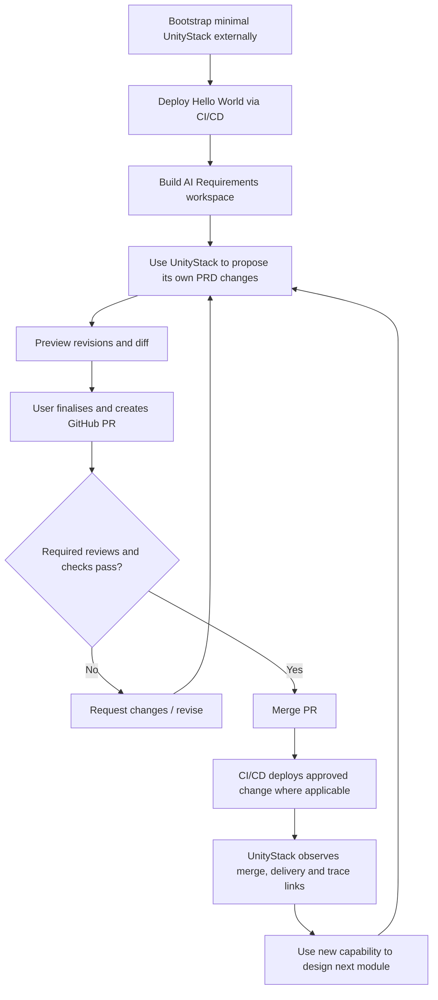

# Scope and roadmap

[← Documentation index](README.md)

What is built when, and how UnityStack is built with UnityStack. This file merges the former PRD scope and acceptance sections with the dogfooding development plan.

## Dogfooding idea

**Build UnityStack using UnityStack.** Start by creating the smallest UnityStack shell with conventional engineering tools, running locally in Docker. Add a usable AI Requirements workspace. Then use that workspace to propose changes to UnityStack's own requirements document through GitHub pull requests (PRs). Build the whole loop thin from end to end first (requirements → stories → code and tests → PR → deploy → logs → AI analysis → bug), using each new stage to help build the next one. Then move to AWS and deepen each stage ([PD-4](decisions.md#pd-4), [AD-2](decisions.md#ad-2)).

This is **dogfooding**: UnityStack becomes its first real customer. The product grows through its own governed delivery loop, while ordinary GitHub/IDE/CI/CD development remains fully supported.

**First product-defining success:** UnityStack reads its own approved requirements Markdown from GitHub; a user discusses a change with AI; the right pane shows a revised document and diff; the user finalises; UnityStack creates a PR; a reviewer or permitted policy merges it; UnityStack recognises the merge and shows the new approved version.

## Dogfooding loop

**Practical limitation:** UnityStack cannot bootstrap itself from nothing. Initial source repositories, CI/CD, cloud infrastructure, application shell and first AI integration are created with Codex, IDEs and normal engineering practices.

## Scope and priorities

Priorities in this document mean:

| Priority | Meaning |
|---|---|
| **P0 — MVP** | Needed for the thin closed loop, used by the sole user ([PD-1](decisions.md#pd-1), [PD-3](decisions.md#pd-3)). |
| **P1 — Next** | Deepens the loop while dogfooding and prepares for a small group of demo users. |
| **P2 — Later** | Enterprise distribution and adoption: installer, full default-tool bundle, BYOT selection, SSO, HA, large-scale ingestion. |

### MVP (P0) — the thin closed loop

- Project Inception ([Requirements phase](requirements/01-requirements.md)) — **built**.
- Requirements workspace: AI edits a Markdown requirements document read from GitHub, with preview, diff, revisions, finalise → PR.
- Architecture and design: AI drafts the HLD with ADRs (monolith or microservices, frontend/backend split, stack, how each NFR is met), the LLD with Mermaid sequence diagrams (all Markdown in Git, published with MkDocs as a shareable docs site), and OpenAPI contracts shown in Swagger UI; a design review PR comes before development (FR-038, FR-039).
- Design of screens: AI drafts Excalidraw wireframes from the approved requirements, then Penpot UX designs and a clickable prototype; both are saved in Git through a PR (FR-037).
- Planning: AI decomposes approved requirements into epics and stories; after merge they are published to the project-management tool through its adapter.
- Sprint planning: the AI proposes the next sprint from the stories (priority, dependencies, capacity); after approval the sprint is created in OpenProject, and development picks stories from the current sprint (FR-133).
- Testing and quality as its own stage after merge: test plan and cases (Kiwi), Playwright end-to-end runs, triage of Semgrep and Trivy findings, and a test report with QA sign-off before deployment (FR-117, FR-120).
- User documentation after each release: Playwright screenshots, an AI-written user guide in Git through a PR, an internal version with requirement links and a public version (site or PDF) without them; comments on the docs can become new requirements (FR-134, FR-135).
- Development: AI proposes code **and tests together** for a story, on a branch, as a PR that carries the Change ID.
- Review and merge through GitHub, with UnityStack reflecting PR status.
- Checks: GitHub Actions runs unit tests (JUnit, Vitest), static code scanning (Semgrep) and dependency/image/secret scanning (Trivy) on every PR. (UnityStack's own code is not deployed by CI while it runs locally; the managed project's pipeline does deploy, see below.)
- Delivery of the managed project: UnityStack deploys the demo application it manages (Hello World first, then a to-do app) through the project's pipeline to **staging and production on AWS**. When the project first reaches deployment, UnityStack asks for the target (cloud, account connection, region, environments) and keeps credentials in a secrets store, never in Git (FR-130). UnityStack itself runs locally during the MVP ([AD-2](decisions.md#ad-2)); the projects it manages deploy to real environments ([AD-6](decisions.md#ad-6)).
- Testing: end-to-end tests with Playwright; test cases kept in Git and each run's results recorded in Kiwi TCMS, linked to requirements, release and Change ID.
- Observe: the deployed application's logs (Loki) and metrics (Prometheus) are collected and viewable in Grafana and from UnityStack; the user can ask AI to analyse them.
- Feedback: AI can propose a bug from log evidence; once the user accepts it, the bug is created in the tracker, linked to the Change ID, and enters the loop again.
- Sign-in and roles through Keycloak ([AD-3](decisions.md#ad-3)).
- Adapters for every tool used above, plus the LLM adapter with a mock provider.
- Change ID created at the start and carried through every stage.
- Everything runs locally in Docker Compose, using profiles ([AD-2](decisions.md#ad-2)).

### Next (P1)

- **Move UnityStack itself to AWS** as soon as the thin loop works: Terraform, EC2 + Docker Compose, HTTPS ([AD-2](decisions.md#ad-2)). CI/CD then builds images, publishes them to the container registry (GitHub Container Registry, then Amazon ECR), deploys each PR to a preview environment and deploys merges to main to the main (production) environment.
- Black-box security testing of the deployed application with OWASP ZAP.
- Alerting and on-call: Grafana alerts page the on-call developer through GoAlert; at the same time AI investigates logs and metrics and adds a summary to the incident.
- Notifications (review requests, alerts, incident summaries) through Mattermost.
- Feature flags through OpenFeature, with Unleash as the provider.
- Second provider behind an existing adapter (Jira for project management) to prove swappability.
- Richer previews.
- Passive observation of work done outside UnityStack, webhook reconciliation and bounded history import.
- My Work queues, workflow orchestration with parallel work and dependencies.
- Multi-user roles and resource permissions ready for demo users.
- Model routing, budgets, RAG over project documents, agent evaluation.

### Later (P2)

- Versioned, installable distribution with Terraform-provisioned AWS, the full default tool profile, upgrade, backup and restore.
- Bring Your Own Tool: the organisation picks the provider for each capability at install time (for example GitHub Container Registry, ECR or Harbor; GitHub Actions, Jenkins or Argo CD; Mattermost, Slack or Teams).
- **AI meeting assistant:** an AI participant in requirement meetings that listens, asks questions, suggests solutions, summarises on request and later proposes requirement updates as PRs ([Communication](requirements/08-communication.md)).
- Enterprise onboarding: connect existing tools, historical backfill, relationship reconstruction, completeness reports.
- Full SSO across all tools, HA, Kubernetes, multi-cloud, cross-repository change sets.

### Explicit exclusions from the MVP

Manual artifact editors inside UnityStack; installing all default tools; hosting UnityStack itself in the cloud (comes straight after, in P1); enterprise installer; SSO across every third-party tool; high availability; multi-tenant SaaS; multi-cloud; autonomous production deployment; atomic cross-repository merges; advanced visual diagram diffs; large-scale historical ingestion.

## MVP acceptance — the thin loop

The MVP is accepted when the sole user can do the following on a demo application (Hello World first), with every step linked by one Change ID:

1. Create a project through Inception and link its GitHub repository; the charter is proposed to Git via PR.
2. Discuss a requirement change with AI, inspect the diff, finalise a revision and get a PR in the mapped repository.
3. After merge, have AI propose epics and stories; after their PR merges, they are published once to the tracker, even if events are replayed.
4. Pick a story; AI proposes code and tests together on a branch; the PR carries the Change ID.
5. On the PR, CI runs unit tests, Semgrep and Trivy; a failing scan or test blocks the merge according to policy. After merge, the pipeline builds the image, publishes it to the registry and deploys it to staging on AWS; after the user approves, it deploys the release to production.
6. Playwright end-to-end tests run against the deployed version, and the run's results are recorded in Kiwi TCMS against the release, linked to the requirement and Change ID.
7. See the deployed version's logs, tagged with the Change ID, from UnityStack.
8. Ask AI whether things work as expected; AI answers with cited log evidence.
9. Accept an AI-proposed bug; it appears in the tracker linked to the Change ID, deployment and log evidence, and can start the next change.
10. View one timeline for the Change ID from requirement to test report to bug; missing links show as gaps.
11. Switch the LLM provider or model by configuration mid-project and continue working without losing context.
12. A PR created directly in GitHub, outside UnityStack, is detected and shown with its source status.
13. No AI action merges, deploys to production or creates a tracker item without the required human action.
14. All of the above works with the user signed in through Keycloak, and an action the user's role does not permit is refused.

## Phased plan

The phases follow the thin loop ([PD-4](decisions.md#pd-4)): Phases 0–4 build every stage of the loop in a basic form; Phase 4 completes the MVP ([Scope and roadmap](#)). Each phase uses what the earlier phases built.

### Phase 0 — Local foundation and walking skeleton (v0.0.x)

**Goal:** A repeatable local stack, signed-in access and an automated pipeline for a Hello World application.

**Already built:** Project Inception ([Requirements phase](requirements/01-requirements.md)) with Vue, Spring Boot, PostgreSQL and the mock/OpenAI LLM adapter in Docker Compose.

**Build:**
- Docker Compose profiles (`core`, `pm`, `test`, `monitoring`, …) so only the needed tools start.
- Keycloak in the `core` profile; UnityStack sign-in and basic roles; realm configuration exported to Git (no secrets).
- Restructure the code into feature modules ([AD-5](decisions.md#ad-5)): move inception and projects into `requirements/`, the LLM interface and providers into `core/ai/` (framework-free, [AD-1](decisions.md#ad-1)), and the frontend views into `modules/requirements/`; add Spring Modulith and its boundary test.
- Capability registry skeleton and the first adapter interfaces (SCM, CI, registry, project management, test management, observability).
- Item identity ([AD-7](decisions.md#ad-7)): UUIDs, short keys such as `TODO-12` and outline labels, created at the start of a change.
- GitHub Actions for UnityStack itself on every PR: build, JUnit and Vitest, Semgrep, Trivy (no deployment).
- `unitystack-demo-app` repository with a Hello World service and the same checks, deployed by its own GitHub Actions pipeline to a small AWS staging and production setup (set up conventionally at first; configured through UnityStack from Phase 3, FR-130).
- Local rebuild workflow: AI runs `docker compose up --build -d <service>` after a batch of edits; `docker compose watch` for manual edits ([Development setup](dev-setup.md)).
- Secrets only in `.env` locally; placeholders in `.env.example`.

**Dogfooding demonstration:** A conventional PR to the demo app changes the Hello World text; CI tests and scans it; after merge, the pipeline deploys the new version to AWS.

**Exit criteria:** Clean repeatable local start; sign-in works; scans and tests run on every PR; no secrets committed.

### Phase 1 — Requirements to PR (v0.1)

**Goal:** Use UnityStack to update its own requirements document.

**Build:**
- Project/repository/artifact configuration for the UnityStack PRD path; charter proposed to Git via PR when a repository is linked ([FR-108](requirements/01-requirements.md)).
- Two-pane UI with chat, Markdown preview, baseline/proposed diff, revision history and finalise action.
- AI requirements flow: retrieve approved Markdown from GitHub; discuss change; produce a structured patch or revised document; validate document shape and identifiers; save draft revision with its Change ID.
- Trusted GitHub integration: create branch, commit proposed Markdown, open PR; show PR URL/status.
- Webhook ingestion plus basic periodic reconciliation for PR merge/rejection status.
- Audit records and policy checks; resource permissions through Keycloak roles and UnityStack rules.

**Dogfooding demonstration:** Ask UnityStack to add a requirement to its own PRD; preview the exact diff; finalise; review and merge the PR; refresh the approved PRD from GitHub.

**Exit criteria:** No direct manual editing inside UnityStack; no PR before finalisation; no overwrite of concurrent upstream changes; every PR links to draft revision, actor and Change ID.

### Phase 2 — Stories to the tracker (v0.2)

**Goal:** Turn approved requirements into reviewable work without manual story entry in UnityStack.

**Build:**
- AI proposes epics, stories and acceptance criteria according to scope; hierarchical preview with change indicators.
- Finalisation → Git PR for canonical YAML/Markdown work definitions → review/merge.
- Architecture and design workspace before development: HLD with ADRs, LLD with Mermaid sequence diagrams (published with MkDocs), OpenAPI contracts in Swagger UI, design review PR (FR-038, FR-039).
- OpenProject adapter (Compose profile `pm`) publishes approved items after merge, with stable external IDs, idempotent retry and the Change ID.

**Dogfooding demonstration:** Decompose a real UnityStack requirement into stories and publish them to OpenProject.

**Exit criteria:** Rejected proposals create no OpenProject records; retries do not duplicate items; stories keep Git, OpenProject and Change ID links.

### Phase 3 — Code and tests to deployment (v0.3)

**Goal:** AI proposes code and tests together for a story; CI scans, tests and deploys them.

**Build:**
- Developer agent reads the linked requirement, story, ADRs, repository context and conventions; proposes code **and** tests in a bounded, isolated workspace; file allowlist; lint and test execution; code diff preview.
- Branch/commit/PR via trusted service after finalisation; PR carries the Change ID; never direct merge or production credentials.
- CI on the PR: unit tests, Semgrep, Trivy. After merge, the pipeline builds the demo app's image (GitHub Container Registry), deploys it to staging and, after approval, to production on AWS, labelled with version, commit SHA and Change ID.
- Deployment target set-up in UnityStack: when the project first deploys, UnityStack asks for cloud, account connection, region and environments, and stores credentials in a secrets store (FR-130).
- Playwright end-to-end tests against the deployed version; test cases in Git; run results recorded in Kiwi TCMS (Compose profile `test`) against the release, with a per-release test report.

**Dogfooding demonstration:** AI implements a small demo-app story with tests; the PR is reviewed and merged; CI deploys it; the Kiwi report shows which tests ran and passed for that release.

**Exit criteria:** Code and tests arrive in one PR; failing tests or scans block per policy; test runs link to requirement, story and Change ID; conventional IDE/PR workflow still works.

### Phase 4 — Observe and feedback: thin loop complete (v0.4, MVP)

**Goal:** See how the deployed change behaves, let AI analyse it, and feed problems back as bugs.

**Build:**
- Demo app instrumented with the OpenTelemetry Java agent; logs (Logback/Log4j with trace IDs), metrics and traces tagged with `service.name`, `service.version` and Change ID.
- OpenTelemetry Collector, Loki, Prometheus and Grafana in Compose profile `monitoring`; observability adapter for querying logs and metrics.
- AI analysis: the user asks whether things work as expected for an environment and time window; answers cite log entries.
- AI proposes a bug from evidence; after the user accepts it, the bug is created in OpenProject with links to Change ID, deployment and logs.
- Change ID timeline view from requirement to stories, PR, tests, deployment, logs and bug; gaps shown, not filled.

**Dogfooding demonstration:** Introduce a small fault in the demo app; AI finds it in the logs, proposes a bug, the bug goes to OpenProject, and the fix goes through the loop again.

**Exit criteria:** [Scope and roadmap](#) MVP acceptance passes.

### Phase 5 — Move UnityStack itself to AWS (v0.5)

**Goal:** Run UnityStack itself in AWS as soon as possible after the MVP ([AD-2](decisions.md#ad-2)). Managed projects already deploy to AWS from the MVP ([AD-6](decisions.md#ad-6)).

**Build:**
- Terraform for EC2, networking, storage and secrets (Secrets Manager or SSM); S3 remote state with locking.
- The same Docker Compose files on EC2; HTTPS; Keycloak behind TLS.
- UnityStack's own CI/CD starts deploying UnityStack: images to GitHub Container Registry (Amazon ECR adapter alongside); merges to main to its environment; GitHub Actions uses OIDC with least-privilege roles.
- Managed projects gain a preview environment per PR (FR-129).
- Optional middle step: move heavy tools (monitoring, test management, chat) to one EC2 host first while the app runs locally.
- Cost controls: stop the instance when not in use; spending alerts.

**Exit criteria:** Clean repeatable deploy to AWS; health checks pass; backups and a restore tested; no secrets committed.

### Phase 6 — Deepen the loop (v0.6)

**Build (each behind its adapter):**
- OWASP ZAP black-box scan after each deployment; findings linked to the deployment and Change ID.
- Grafana alerting rules kept in Git and provisioned into Grafana (export sync opens a PR on drift) → GoAlert on-call paging with rotations, overrides and escalation; the same alert reaches UnityStack, where AI investigates and adds a summary to the incident.
- Mattermost notifications for review requests, alerts, incident summaries and failures.
- Feature flags through OpenFeature with Unleash.
- Jira adapter to prove project-management swappability.
- Deterministic workflow engine, My Work queues, parallel work and dependencies.

**Dogfooding demonstration:** A production-like alert pages the developer, and AI's summary is already on the incident when they open it.

### Phase 7 — Passive intelligence and demo users (v0.7)

**Build:**
- GitHub webhooks for PRs, commits, reviews and merges; OpenProject events where supported; CI/CD ingestion; reconciliation, deduplication, checkpoints and replay.
- Bounded import of historical GitHub/OpenProject records with source IDs, URLs, timestamps and evidence; verified vs AI-inferred links.
- Multi-user roles and resource permissions; onboard a few developers for free demos.

**Dogfooding demonstration:** A developer creates a story and completes a PR entirely outside UnityStack; UnityStack discovers the work and links its evidence.

### Phase 8 — Enterprise distribution and onboarding (v0.8+)

**Build:**
- Versioned AWS installer and manifests; installation profiles, preflight checks, health validation, upgrade/rollback, backup/restore.
- Install-time choice of provider per capability (for example GitHub, Gitea, GitLab or Bitbucket; GitHub Container Registry, ECR or Harbor; GitHub Actions, Jenkins or Argo CD; Mattermost, Slack or Teams), with the default open-source set as the full profile.
- Organisation configuration, identity federation, domain/TLS, secrets and tool health.
- Greenfield install or connect-existing onboarding; historical ingestion plus ongoing synchronisation.
- Future: AI meeting assistant that joins requirement meetings, summarises them and proposes requirement updates ([FR-126](requirements/08-communication.md)).

**Exit criteria:** Repeatable fresh install, upgrade and restore tested; onboarding report identifies imported records, gaps and integration health.

## MVP scope boundaries

**MVP (v0.4, thin loop) includes:** Inception; requirements AI conversation with GitHub PRD retrieval, preview, diff, revisions and finalise → PR; Excalidraw wireframes and Penpot UX designs through PRs; HLD with ADRs, LLD with sequence diagrams, OpenAPI contracts and a design review PR; stories published to OpenProject; AI code and tests in one PR; CI checks with unit tests, Semgrep and Trivy; deployment target set up in UnityStack; release, image in GitHub Container Registry, deployment to staging and (after approval) production on AWS; monitoring of staging and production; Playwright tests with results in Kiwi TCMS; OpenTelemetry logs, metrics and traces in Grafana, Loki and Prometheus; AI log analysis; accepted bugs back in OpenProject; Change ID timeline; Keycloak sign-in; status synchronisation; audit; conventional GitHub workflow compatibility.

**Not required for the MVP:** hosting UnityStack itself on AWS (Phase 5); preview environment per PR; OWASP ZAP; alerting and on-call; Mattermost; feature flags; Jira; manual artifact editors; full multi-agent autonomy; multi-cloud; enterprise historical ingestion; sophisticated visual diagram diffs; production-grade HA.

**Full enterprise vision remains:** installable AI Software Factory, tool-provider choices per capability, independent SDLC observation, historical ingestion, workflow intelligence and end-to-end delivery traceability.

## Work items and prioritisation

**Immediate implementation order:**

1. Docker Compose profiles and Keycloak sign-in.
2. Restructure backend and frontend into feature modules, with the Spring Modulith boundary test.
3. Change ID scheme and generation.
4. GitHub Actions with unit tests, Semgrep and Trivy on every PR.
5. `unitystack-demo-app` Hello World deployed by its pipeline to AWS staging and production.
6. GitHub read of the approved PRD; chat and structured AI proposal endpoint.
7. Preview, revision persistence and diff; finalisation, branch/commit/PR and error handling.
8. Webhook status updates and periodic PR reconciliation; dogfood one real requirements change end to end.
9. Stories → OpenProject; code and tests → PR → deploy; Playwright and Kiwi; logs, AI analysis and bugs.

**Suggested vertical-slice backlog:**

| ID | Story | Evidence of completion |
|---|---|---|
| PRJ-01 | Create a project via AI inception | Done: project + charter revision 1 stored after explicit confirmation |
| BOOT-01 | Deploy Hello World | Demo app reachable on its AWS production URL; smoke test passes |
| BOOT-02 | Sign in through Keycloak | Only signed-in users reach UnityStack; roles visible |
| BOOT-03 | Scan and test every PR | Unit tests, Semgrep and Trivy run in CI; failures block per policy |
| CHG-01 | Create item keys | Every new requirement, story or change gets a UUID and a short key (e.g. `TODO-12`) carried into branch, PR and build |
| REQ-01 | Load PRD from GitHub | Correct repo/path/ref and SHA shown |
| REQ-02 | Discuss a requirement change | AI returns validated proposed revision |
| REQ-03 | Show preview and diff | Exact additions/deletions visible |
| REQ-04 | Keep draft revisions | Previous draft accessible; baseline unchanged |
| GOV-01 | Finalise and create PR | GitHub PR contains only intended changes |
| GOV-02 | Track review/merge | UI reflects GitHub source state |
| GOV-03 | Enforce policies | Unauthorised merges/actions rejected |
| SYNC-01 | Recover missed webhook | Scheduled reconciliation restores status |
| DOG-01 | Update UnityStack PRD with UnityStack | Merged PR becomes approved baseline |
| PLAN-01 | Publish stories to OpenProject | Stories appear once, linked to Git and Change ID |
| DEV-01 | AI code and tests in one PR | PR contains code and tests for the story |
| TEST-01 | Run Playwright against the deployment | E2E results in CI |
| TEST-02 | Record test runs in Kiwi TCMS | Per-release report lists tests run and passed |
| OBS-01 | Logs and metrics in Grafana | Demo app logs tagged with Change ID visible |
| OBS-02 | AI log analysis | AI answer cites log entries |
| FB-01 | Accepted bug to OpenProject | Bug linked to Change ID, deployment and logs |
| TRACE-01 | Change ID timeline | Requirement → bug timeline, gaps shown |

## Measuring success

| Milestone | Demonstrable outcome |
|---|---|
| v0.0.x | A conventional PR to the demo app is tested, scanned and deployed to AWS by its pipeline; sign-in through Keycloak |
| v0.1 | UnityStack updates its own PRD via AI preview and GitHub PR |
| v0.2 | UnityStack generates approved stories and publishes them to OpenProject |
| v0.3 | UnityStack proposes code and tests in one PR; CI deploys it; Kiwi shows the release's test results |
| v0.4 | Thin loop complete: logs analysed by AI, accepted bug back in OpenProject, one Change ID timeline (MVP) |
| v0.5 | The same loop runs in AWS, with per-PR preview environments and a main environment |
| v0.6 | DAST, on-call alerts with AI incident summaries, notifications, feature flags and a second tracker adapter work |
| v0.7 | External-only story/PR activity appears without UnityStack participation; first demo users onboarded |
| v0.8+ | A new organisation can install, choose its tools, connect, ingest and begin using the platform |

Track practical engineering measures: PR success rate, AI revision acceptance rate, escaped defects, time from proposal to merge, deployment frequency, change failure rate, recovery time, sync lag, ingestion coverage and cost per AI task. Establish baselines before setting numerical targets.

## First sprint: definition of done

The first sprint is complete when a developer can clone the repositories, run `docker compose --profile core up`, sign in through Keycloak, submit a PR to the demo app that passes unit tests, Semgrep and Trivy, merge it with the required review, and see the pipeline deploy the healthy new Hello World version to AWS. Document the start, deployment and recovery commands. Then begin Phase 1 with the approved UnityStack requirements document in GitHub.

---

**Guiding statement:** *We will build the smallest UnityStack that can improve UnityStack, then use each approved capability to help build the next one—without disrupting conventional software engineering.*
